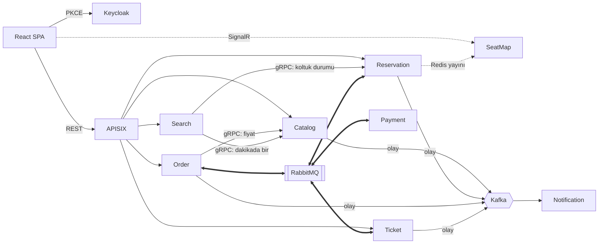
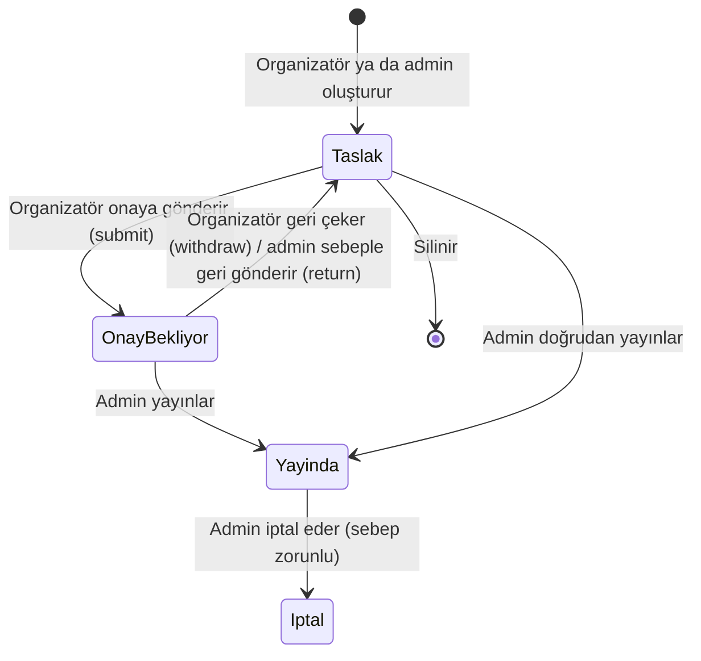
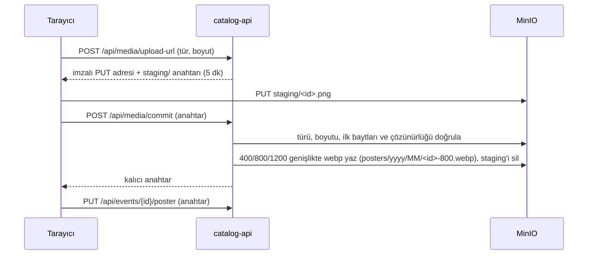
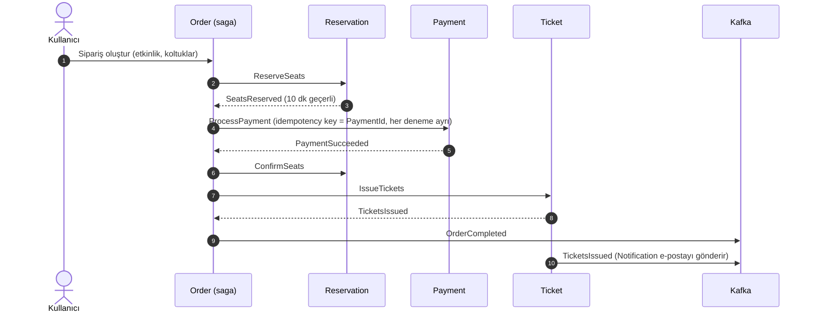
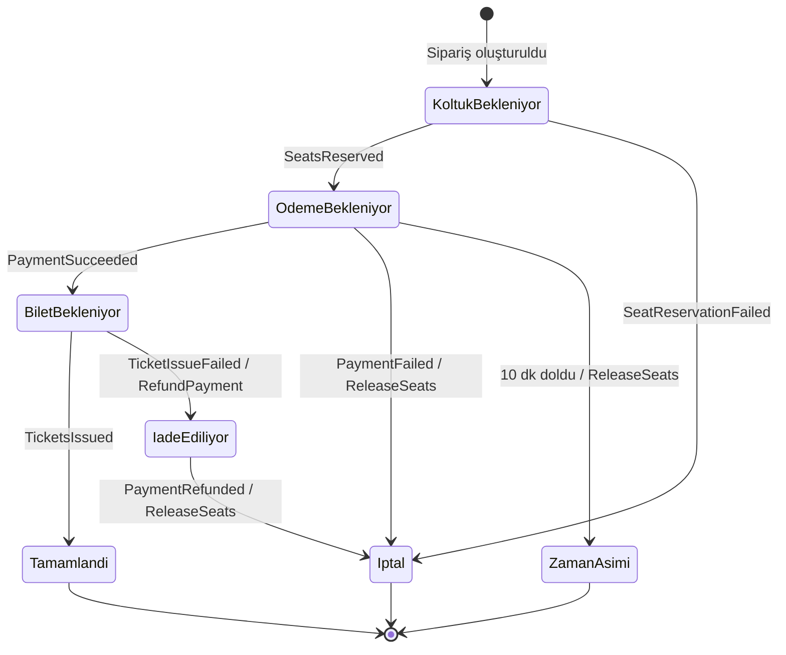
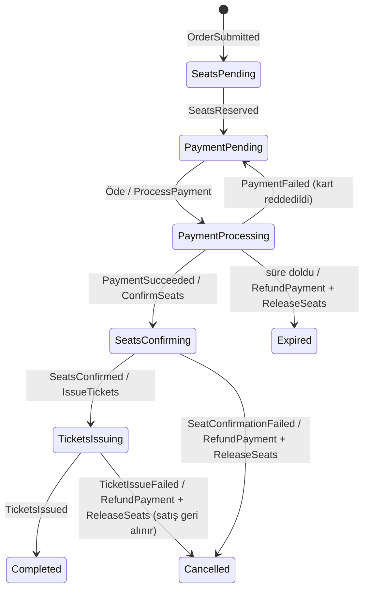

# Gişe — Tasarım Belgesi

> Durum: **Taslak** · Son güncelleme: 2026-10-17

Gişe; konser, tiyatro ve maç gibi etkinlikler için koltuklu bilet satan bir platformdur. Projenin teknik kalbi, satış anında binlerce kişinin aynı koltuklar için yarıştığı durumda **bir koltuğun yalnızca bir kişiye satılmasını** ve ödeme, bilet üretimi gibi adımlardan biri başarısız olduğunda **önceki adımların güvenle geri alınmasını** sağlamaktır.

---

## 1. Hedefler

**Öğrenme hedefleri**
- Saga deseni: orkestrasyon, telafi işlemleri, zaman aşımları
- Yüksek eşzamanlılıkta veri tutarlılığı: süreli koltuk kilidi, idempotency
- İki mesajlaşma modelinin farkı: **kuyruk** (RabbitMQ) ve **olay günlüğü** (Kafka)
- İlk günden test, CI/CD ve canlıya çıkış

**Kapsam dışı (şimdilik)**
- Gerçek ödeme sağlayıcısı (sahte bir sağlayıcı kullanılır)
- Çok dilli arayüz, mobil uygulama
- Etkinlik organizatörü için gelişmiş raporlama

---

## 2. Temel kararlar

| Konu | Karar | Gerekçe |
|---|---|---|
| Servis yapısı | Her servis kendi veritabanına sahip; 5 katman (Domain, Application, Persistence, Infrastructure, Api) | Telgraf'ta oturan yapı |
| Komutlar ve saga | **RabbitMQ + MassTransit** | Kuyruk, yeniden deneme, gecikmeli mesaj ve saga durum makinesi hazır |
| Olay akışı | **Kafka**, **KRaft** modunda (Zookeeper yok) | Olmuş bitmiş gerçekleri birden çok tüketiciye dağıtmak, geriye dönük okuma |
| Güvenilir mesajlaşma | **Kendi yazdığımız outbox ve inbox** (Kafka tarafı) | Desen üzerinde bilerek pratik yapmak; bkz. 2.2 |
| Ödeme | **Test sağlayıcı**; senaryolar test kart numaralarıyla seçilir | Gerçek sağlayıcı kapsam dışı; bkz. 3.2 |
| Gateway | **Apache APISIX** | Bilinen araç; istek sınırı ve route'lar kod olarak tutulur |
| Kimlik | **Keycloak**, SPA'da **PKCE'li authorization code** | Uygulama parolayı görmez (Telgraf'taki password grant dersinden) |
| Servisler arası senkron çağrı | **gRPC** (yalnızca gerektiği yerde) | Tip güvenli, hızlı; ör. Order → Catalog fiyat doğrulama |
| Veri | PostgreSQL (servis başına ayrı veritabanı), Redis, MinIO | |
| Gözlemlenebilirlik | **OpenTelemetry** → Grafana, Tempo, Loki, Prometheus | Elastic Stack'ten hafif ve standart |
| Arayüz | React + Vite | |
| Test | xUnit, MassTransit test harness, **Testcontainers**, k6 | |
| CI/CD | GitHub Actions (ilk günden) | |

### 2.1 RabbitMQ mı, Kafka mı? Kural

İki altyapı bilerek birlikte kullanılıyor. Hangi mesajın nereden gideceği şu kurala göre belirlenir:

| | RabbitMQ (kuyruk) | Kafka (olay günlüğü) |
|---|---|---|
| Mesajın anlamı | **"Şunu yap"** (komut) ya da bir komutun cevabı | **"Şu oldu"** (gerçekleşmiş olay) |
| Kaç alıcı | Bir alıcı | Sıfır ya da çok alıcı; gönderen kimin dinlediğini bilmez |
| Saga'nın parçası mı | Evet | Hayır; saga'nın sonucunu dışarıya duyurur |
| Okunduktan sonra | Silinir | Saklanır; yeni bir tüketici geçmişi baştan okuyabilir |
| Örnek | `ReserveSeats`, `ProcessPayment`, `RefundPayment` | `OrderCompleted`, `TicketsIssued`, `EventPublished` |

**Kısaca:** Bir iş akışını yürüten mesajlar RabbitMQ'dan, sistemin geri kalanına "bu oldu" diyen mesajlar Kafka'dan gider. Bildirim, arama ve koltuk haritası saga'yı **yavaşlatmamalı ve bozmamalı**. Bu yüzden Kafka'yı dinlerler; e-posta gönderilemese bile satış tamamlanmış sayılır.

### 2.2 Outbox ve inbox

Desen bu projede **bilerek iki farklı şekilde** kullanılır:

| | Kafka olayları | RabbitMQ saga mesajları |
|---|---|---|
| Uygulama | **Kendimiz yazarız** | MassTransit'in hazır transactional outbox/inbox'ı |
| Neden | Deseni elle kurup her parçasını anlamak | Aynı desenin bir kütüphanede nasıl yapıldığını görüp karşılaştırmak |

**Outbox (gönderen taraf)**
- İş verisi ile olay **aynı transaction'da** `OutboxMessages` tablosuna yazılır. Olay ya veriyle birlikte kaydedilir ya hiç kaydedilmez.
- Bir arka plan işi bekleyen satırları `FOR UPDATE SKIP LOCKED` ile alır ve Kafka'ya gönderir. Böylece birden fazla kopya aynı satırı iki kez göndermez.
- Başarısız gönderim, artan bekleme süreleriyle yeniden denenir; sınır aşılınca dead-letter olarak işaretlenir ve sağlık kontrolü bunu bildirir.
- Her satır, isteğin trace bilgisini (`traceparent`) taşır; iz Kafka'nın öbür tarafında devam eder.
- İşlenmiş satırlar belli bir süre sonra temizlenir.

**Inbox (alan taraf)**
- Kafka'dan gelen mesaj önce `InboxMessages` tablosuna yazılır. `MessageId` üzerindeki **tekil indeks**, aynı mesaj iki kez gelirse ikincisinin kaydedilmesini engeller.
- Asıl iş (e-posta göndermek, koltuk stoğunu güncellemek) ayrı bir işlemci tarafından yapılır ve başarısız olursa yeniden denenir. Kafka'dan okuma ile işi yapma birbirinden ayrılır.
- Kafka offset'i, mesaj inbox'a yazıldıktan **sonra** onaylanır; arada çökme olursa mesaj yeniden gelir ve inbox tekrarı yakalar.


**Mesajlaşma worker'larda (her servis için aynı kural, 2026-10-28)**
- API'ler (`*-api`) yalnızca HTTP'ye cevap verir ve göndereceği mesajı outbox'a yazar; hiçbir Kafka ya da RabbitMQ mesajını dinlemez.
- Mesajı göndermek ve dinlemek ayrı worker'lardadır (`src/Workers/`), her worker tek iş yapar. API çökse de mesaj akışı sürer; worker çökerse mesajlar outbox'ta ya da kuyrukta bekler, kaybolmaz.
- RabbitMQ tarafında API, MassTransit'in bus outbox'ını gönderimi kapalı olarak kullanır (`DisableDeliveryService`). RabbitMQ'ya yine bağlanır, çünkü outbox'a yazılan hedef adresleri RabbitMQ'nunkiler olmalı. Gönderimi ilgili worker yapar; API ayrı process olduğu için worker outbox'ı her `Outbox:QueryDelaySeconds` (1 sn) taramada okur.

| Servis | Worker | İşi |
|---|---|---|
| Catalog | `catalog-outbox-worker` | Kafka outbox'ını gönderir |
| Reservation | `reservation-inbox-worker` | Kafka'dan okur, inbox'a yazar ve işler (koltuk stoğu) |
| Reservation | `reservation-command-worker` | RabbitMQ: `ReserveSeats`, `ReleaseSeats`, `ConfirmSeats` |
| Order | `order-saga-worker` | Satın alma saga'sı, zaman aşımları (Quartz), Order outbox'ının gönderimi |
| Payment | `payment-command-worker` | RabbitMQ: `ProcessPayment`, `RefundPayment` (test sağlayıcısı) |
| Ticket | `ticket-command-worker` | RabbitMQ: `IssueTickets` (bilet, PDF, QR) |
| Ticket | `ticket-inbox-worker` | Kafka'dan okur, inbox'a yazar ve işler (iptal edilen etkinliğin biletleri) |
| Ticket | `ticket-outbox-worker` | Kafka outbox'ını gönderir (`TicketsIssued`) |
| Order | `order-inbox-worker` | Kafka'dan okur, inbox'a yazar ve işler (iptal edilen etkinliğin tamamlanmış siparişlerini iade eder) |
| Notification | `notification-inbox-worker` | Kafka'dan okur (`catalog.events`, `ticket.events`), inbox'a yazar ve işler (e-postalar) |
| Search | `search-sync-worker` | Arama dizinini Catalog'dan (etkinlikler) ve Reservation'dan (koltuk durumu) gRPC ile dakikada bir baştan kurar; Kafka dinlemez |

Telgraf'tan farkı: orada Kafka tüketicisi API'nin içindeydi.

---

## 3. Servisler

| Servis | Sorumluluk | Veri | Dışarıya açtığı | Gönderdiği | Dinlediği |
|---|---|---|---|---|---|
| **Catalog** | Etkinlik, mekân, salon/koltuk planı, fiyat kategorisi, afiş | PostgreSQL + MinIO (afişler) | REST (okuma herkese; taslak organizatöre, yayın ve iptal admin'e), gRPC (koltuk ve fiyat) | Kafka: `EventPublished`, `EventUpdated`, `EventCancelled` | — |
| **Reservation** | Koltuk tutma (10 dk), kesinleştirme, bırakma; çift satışı önleme | PostgreSQL + Redis | REST (koltuk durumu) | RabbitMQ: `SeatsReserved`, `SeatReservationFailed`; Redis yayını: `SeatsChanged` (SeatMap) | RabbitMQ: `ReserveSeats`, `ConfirmSeats`, `ReleaseSeats`; Kafka: `EventPublished`, `EventUpdated`, `EventCancelled` |
| **Order** | Satın alma saga'sı (orkestratör) | PostgreSQL (saga durumu) | REST (sipariş oluştur/sorgula, öde) | RabbitMQ: komutlar | RabbitMQ: komut cevapları; Kafka: `EventCancelled` |
| **Payment** | Sahte ödeme sağlayıcısı; iade | PostgreSQL | — | RabbitMQ: `PaymentSucceeded`, `PaymentFailed` (iadenin cevabı beklenmez) | RabbitMQ: `ProcessPayment`, `RefundPayment` |
| **Ticket** | QR'lı PDF bilet üretimi; kapıda okutma | PostgreSQL + MinIO | REST (biletlerim, PDF indirme, kapı okutma) | RabbitMQ: `TicketsIssued`, `TicketIssueFailed`; Kafka (`ticket.events`): `TicketsIssued` | RabbitMQ: `IssueTickets`; Kafka: `EventCancelled` |
| **Notification** | E-posta | PostgreSQL (inbox, bilet sahipleri, gönderilenler) | — | — | Kafka: `TicketsIssued`, `EventCancelled`, `EventUpdated` |
| **Search** | Ana sayfadaki liste, Türkçe tam metin arama, yazarken öneri | Elasticsearch | REST (herkese açık) | — | — (Catalog'dan ve Reservation'dan gRPC ile dakikada bir alır) |
| **SeatMap** | Koltuk haritasında anlık güncelleme | — | SignalR (`/hubs/seatmap`) | — | Redis yayını: `SeatsChanged` (Reservation'dan) |

### 3.1 Mimari



### 3.2 Test ödeme sağlayıcısı

Payment servisi gerçek bir sağlayıcıya bağlanmaz. Sonuç, kart numarasının son dört hanesine göre belirlenir; böylece testlerde ve elle denemede her senaryo bilerek seçilebilir:

| Kart sonu | Sonuç |
|---|---|
| `0000` | Başarılı |
| `0002` | Reddedildi (yetersiz bakiye) |
| `0005` | Zaman aşımı: yanıt hiç gelmez, saga'nın zaman aşımı devreye girer |
| `0009` | İlk deneme hata verir, yeniden denemede başarılı olur |

Diğer sonlar başarılı sayılır. İade (`RefundPayment`) her zaman başarılıdır; telafi yolunun kendisini test etmek için ayrıca bir "iade başarısız" kartı eklenebilir.

`0009`'un "ilk deneme" bilgisi worker'ın belleğinde tutulur; yeniden deneme aynı process'te yapıldığı için (MassTransit retry, 1 sn sonra) yeterli.

### 3.3 Catalog: fiyatlar

Fiyat **bölüm başına** belirlenir: her bölümün bir etkinlikte tek fiyatı olur (A Blok 750 ₺, Balkon 400 ₺). Para birimi şimdilik TRY.

- `PUT /api/events/{id}/prices` listeyi bütün olarak ayarlar; listede olmayan bölümün fiyatı kalkar.
- Taslağın fiyatını sahibi olan organizatör ya da admin, yayındakinin fiyatını yalnızca admin belirler (bkz. 3.4).
- Bölüm, etkinliğin mekânına ait olmalıdır. Fiyat 0'dan büyük, en fazla 1.000.000 ₺ ve en fazla 2 ondalık basamaklı olur.
- Yayındaki etkinliğin fiyatı da değişebilir; yalnızca bundan sonraki satışları etkiler. Satılmış biletler için fark iadesi ya da ek ücret olmaz, çünkü Order fiyatı sipariş anında kendine kaydeder. Reservation fiyatları yayın anında gRPC ile alır; `EventUpdated` gelince yeniden okumalıdır.
- **Yayınlama** (`POST /api/events/{id}/publish`): yalnızca admin; taslak ya da onay bekleyen, henüz başlamamış etkinlik. Mekânın **her bölümünün** fiyatı girilmiş olmalıdır, yoksa satılamayan koltuk kalır (422, eksik bölümler `detail`'de). Yayındaki etkinlik tekrar yayınlanamaz (409).
- Yayındaki etkinlikte fiyat değişebilir ama listeden bölüm çıkarılamaz; her bölüm yine fiyatlı kalmalıdır.
- **Taslak görünürlüğü:** Taslak ve onay bekleyen etkinliğin detayını (`GET /api/events/{id}`) yalnızca sahibi olan organizatör ve admin görür; diğer herkes 404 alır. 403 dönülmez, çünkü etkinliğin var olduğunu ele verirdi. gRPC zaten yalnızca yayındaki etkinlikleri döndürür.
- Herkese açık etkinlik listesi Catalog'da değil, Search'tedir (bkz. 3.10); en düşük fiyat (`minPrice`) oraya Catalog'dan gRPC ile gelir.
- `GET /api/events/mine`: organizatörün kendi etkinlikleri, taslaklar dahil. Ön yüzde "Etkinliklerim" sayfası bunu kullanır; fiyat girme, onaya gönderme ve yayınlama etkinlik detay sayfasındadır.
- Yayınlanınca `EventPublished` olayı aynı transaction'da outbox'a yazılır (bkz. 3.5).

### 3.4 Catalog: mekân ve etkinlik yönetimi

**Mekân** (yalnızca admin; ön yüzde "Mekânlar" sayfası):

- `PUT /api/venues/{id}`: ad ve şehir her zaman değişir.
- `PUT /api/venues/{id}/layout`: bölüm düzeni yalnızca mekânda **hiç etkinlik yokken** (taslak dahil) değişir; varsa 422 `VENUE_HAS_EVENTS`. Fiyatlar ve Reservation'ın koltuk stoğu bölümlere bağlıdır.
- `DELETE /api/venues/{id}`: yalnızca etkinliği olmayan mekân silinir (aynı kural).

**Etkinlik:** organizatör taslak hazırlar ve onaya gönderir; yayınlama, yayındaki etkinliği değiştirme ve iptal admin'in işidir. Durumlar: **Taslak → Onay bekliyor → Yayında → İptal**.



| | Taslak | Onay bekliyor | Yayında | İptal |
|---|---|---|---|---|
| Ad, tarih (`PUT /api/events/{id}`) | Sahibi, admin | Kimse (422 `EVENT_IN_REVIEW`) | Yalnızca admin (organizatöre 403 `EVENT_ADMIN_ONLY`); `EventUpdated` gider | Kimse |
| Mekân | Sahibi, admin; fiyatlar silinir | Kimse | Kimse (422 `EVENT_VENUE_LOCKED`): koltuk stoğu mekâna bağlı | Kimse |
| Fiyat (`PUT .../prices`) | Sahibi, admin | Kimse | Yalnızca admin; `EventUpdated` gider | Kimse |
| Afiş (`PUT .../poster`) | Sahibi, admin | Kimse | Yalnızca admin | Kimse |
| Onaya gönder (`POST .../submit`) | Sahibi, admin; her bölüm fiyatlı olmalı | — | — | — |
| Geri çek (`POST .../withdraw`) | — | Sahibi, admin | — | — |
| Geri gönder (`POST .../return`, sebep zorunlu) | — | Yalnızca admin | — | — |
| Yayınla (`POST .../publish`) | Yalnızca admin | Yalnızca admin | 409 | — |
| Sil (`DELETE /api/events/{id}`) | Sahibi, admin | Önce geri çekilir | Silinmez; iptal edilir | Silinmez |
| İptal (`POST .../cancel`) | Edilmez, silinir | Edilmez | Yalnızca admin; `EventCancelled` gider | Tekrar edilmez |

- Başka organizatörün etkinliği 403 `EVENT_NOT_OWNER`.
- Admin'in geri gönderme sebebi taslakta organizatöre gösterilir; yeniden gönderince ya da yayınlanınca silinir.
- `GET /api/events/pending` (yalnızca admin): tüm organizatörlerin onay bekleyen etkinlikleri. Ön yüzde "Onay bekleyenler" sayfası.
- Onaya gönderme ve geri çekme olay üretmez; onay bekleyen etkinliği başka servis bilmez.
- Başlamış ya da geçmiş etkinlikte hiçbir değişiklik yapılmaz (422 `EVENT_ALREADY_STARTED`).
- İptal **geri alınamaz** ve sebep zorunludur (en fazla 500 karakter). İptal edilen etkinlik genel listeden kalkar; detay sayfası herkese açık kalır ve "iptal edildi" uyarısını tarih ve sebeple gösterir. Organizatörün "Etkinliklerim" sayfasında "İptal" rozetiyle görünür.
- Taslağı başka servis bilmediği için taslaktaki değişiklik ve silme olay üretmez.
- Ad ya da tarih aynı kalırsa (yalnızca kaydet'e basıldıysa) `EventUpdated` gönderilmez.
- Ön yüzde hepsi etkinlik detay sayfasının "Yönetim" bölümündedir; kullanıcı yalnızca rolüne ve duruma göre yapabildiklerini görür. Silme ve iptal tarayıcı onayı ister.

### 3.5 Catalog: olaylar ve gRPC

- **`EventPublished`** (`Gise.Contracts/Events`) küçük bir olaydır: etkinlik, mekân, başlık, tarih, mekân adı, şehir ve en düşük fiyat. Koltuk listesi olayda **yoktur**; her servis kendi ihtiyacını Catalog'a sorar.
- **`EventUpdated`** aynı alanları ve `PreviousStartsAt`'i taşır; tarih değiştiyse bilet sahiplerine bildirim bununla gider.
- **`EventCancelled`**: etkinlik, sebep ve iptal zamanı. Reservation satışı durduracak, Order ve Payment iade başlatacak.
- Olayları `IOutboxMessageRepository.AddCatalogEventAsync` yazar: `Type` olayın sınıf adı, anahtar etkinlik ID'si.
- Olaylar `catalog.events` topic'ine gider. Anahtar etkinlik ID'sidir, böylece aynı etkinliğin olayları aynı bölüme düşer ve sırası korunur. Başlıklar: `type` (ör. `EventPublished`), `message-id` (alan tarafın inbox'ı tekrarı bununla yakalar), `traceparent`.
- **`catalog-outbox-worker`** (`src/Workers/Catalog/Gise.Catalog.OutboxWorker`), Telgraf'taki outbox worker'lar gibi catalog-api'den **ayrı bir process**: API çökse de bekleyen olaylar gönderilmeye devam eder. Kendi `OutboxWorkerDbContext`'i yalnızca outbox tablosunu görür; tabloyu catalog-api'nin migration'ları kurar. Birkaç saniyede bir bekleyen satırları `FOR UPDATE SKIP LOCKED` ile alıp gönderir; aynı anahtarın daha eski bir olayı beklerken yenisi onu geçmez. Gönderilemeyen satır artan aralıklarla (en fazla 5 dk) yeniden denenir; `MaxRetryCount` aşılınca dead-letter olur. Gönderilmiş satırlar `RetentionDays` sonra silinir. Ayarlar worker'ın appsettings'inde: `Kafka` ve `Outbox` bölümleri.
- Worker'ın `/health/ready` ucu: döngü dönüyor mu (heartbeat, `src/Shared/Gise.HealthChecks`), Postgres erişilebilir mi, dead-letter var mı (varsa "Degraded").
- Topic'i olayı yayan servis açılışta oluşturur; Kafka'da otomatik oluşturma kapalıdır.
- Kafka olayları varsayılanla **7 gün** tutar; daha eski olaylar topic'te yoktur. Sonradan eklenen bir dinleyici geçmişi topic'ten okuyamaz.
- **gRPC** (`Gise.Contracts/Protos/catalog.proto`): `GetEventSeats(event_id)` yayındaki etkinliğin koltuklarını bölüm, sıra, numara ve kuruş cinsinden fiyatla döndürür. Reservation, `EventPublished` gelince stoğu bununla kurar. `ListPublishedEvents(page, page_size)` yayındaki, henüz başlamamış etkinlikleri tarih ve ID sırasıyla sayfa sayfa döndürür (sayfa en fazla 500); Search dizini bununla düzenli olarak baştan kurar (bkz. 3.10). Catalog bunları yalnızca **8081** portunda (HTTP/2) sunar; bu port Docker ağının dışına ve gateway'e açık değildir. Hatalar gRPC durum koduna çevrilir: 404 → `NotFound`, iş kuralı → `FailedPrecondition`; `error-code` başlığı merkezi hata kodunu taşır.
- Servisler arası kimlik doğrulama (Keycloak servis token'ı) henüz yok.
- Biçim kuralları (fiyat aralığı, ondalık, tekrar eden bölüm) validator'da; veritabanına bakan kurallar (sahiplik, iptal, bölümün mekâna ait olması) `SetEventPricesCommandHandler`'da.


### 3.6 Catalog: afişler

Telgraf'taki görsel yüklemeyle aynı akış. Dosya API'den geçmez; tarayıcı MinIO'ya doğrudan yükler.



- **Kurallar** (`Storage` bölümü, appsettings): JPEG, PNG, WebP, AVIF; en fazla 5 MB ve 40 megapiksel. Küçük bir dosyanın çok büyük bir görüntüye açılıp belleği doldurması bu sınırla önlenir. Tür beyana değil dosyanın ilk baytlarına göre doğrulanır; uymayan dosya silinir.
- Boyutlandırma **SkiaSharp** ile (MIT). Telgraf'taki ImageSharp'ın 4.1.2 öncesi sürümlerinde görsel çözmede bilinen açıklar var; sonraki sürümler lisans anahtarı istiyor.
- **Bucket** `gise-media`: yalnızca `posters/` herkese açık okunur (her görüntüleme için imzalı adres üretmek tarayıcı önbelleğini bozardı). `staging/` açık değildir ve 1 gün sonra silinir. Kurulum: `docker compose -f deploy/docker-compose.yml --profile setup up minio-init` (`deploy/minio/setup.sh`, tekrar çalıştırılabilir).
- MinIO'nun API portu (9000) yalnızca `127.0.0.1`'e açık; CORS yalnızca `http://localhost:8000`'e izin verir.
- Etkinlik yalnızca anahtarı tutar (`PosterKey`); yanıtlar `posterUrl` (800'lük boy) ve `posterSrcset` döndürür, tarayıcı ekrana uyan boyu seçer. Afiş yoksa ön yüz renkli yer tutucuyu çizer.
- Afiş bilgi ve fiyatla aynı yetki kurallarına tabidir (bkz. 3.4).
- **Kod:** diğer uçlar gibi MediatR üzerinden: `CreateUploadUrlCommand`, `CommitUploadCommand`, `GetMediaPolicyQuery`. Beyan edilen tür ve boyut ile anahtarın biçimi (`staging/<32 hane>.<uzantı>`) validator'da (400 `VALIDATION_FAILED`); depodaki gerçek dosyanın kontrolü (tür, boyut, ilk baytlar, çözünürlük) `S3StorageService.CommitAsync`'te (422 `MEDIA_*`). Telgraf'tan farkı: orada `MediaController` depolama servisini doğrudan çağırıyordu.
- **Henüz yok:**
  - Değiştirilen ya da kaldırılan afişin eski dosyaları silinmiyor.
  - Uygulama MinIO'ya kök kullanıcıyla bağlanıyor (Telgraf'taki gibi); canlıda yalnızca bu bucket'a yetkili ayrı bir kullanıcı olmalı.


### 3.7 Reservation: koltuk stoğu

Reservation, Catalog'un olaylarını Kafka'dan alır ve her yayındaki etkinlik için kendi koltuk stoğunu tutar. Koltuk haritası ve satış Catalog'a sormadan çalışır. Okuma ve işleme aynı worker'da (`src/Workers/Reservation/Gise.Reservation.InboxWorker`, compose'da `reservation-inbox-worker`), iki ayrı parça olarak çalışır:

- **Tüketici** (`CatalogEventsConsumer`): `catalog.events`'ten okur, mesajı `message-id` başlığıyla `inbox_messages`'a yazar (aynı mesaj ikinci kez yazılmaz), sonra offset'i onaylar. Yazamazsa okuma konumunu geri sarar; mesaj atlanmaz.
- **İşlemci** (`Worker`): inbox'ı işler:
  - Aynı etkinliğin olayları geldiği sırayla işlenir; birden çok kopya `FOR UPDATE SKIP LOCKED` ile çakışmaz.
  - Her mesaj kendi transaction'ında işlenir; hata olursa yarım değişiklik geri alınır, artan aralıklarla yeniden denenir, `MaxRetryCount` aşılınca dead-letter olur.
  - Sağlık: heartbeat, Postgres, dead-letter (`/health/ready`).

| Olay | Reservation'da |
|---|---|
| `EventPublished` | Koltuklar Catalog'dan gRPC ile alınır (`GetEventSeats`); stok kurulur: bölüm, sıra, numara ve fiyatın kopyası. Olay ikinci kez gelirse stok zaten vardır. Etkinlik bu arada iptal edildiyse stok iptal olarak açılır. |
| `EventUpdated` | Tarih güncellenir; olay yalnızca en düşük fiyatı taşıdığı için bölüm fiyatları Catalog'dan yeniden okunur. |
| `EventCancelled` | Satış kapanır (`CancelledAt`); tutulan koltuklar bırakılır. Satılmış koltukların iadesi Order'ın işi (bkz. 4.4). |

- `GET /api/reservation/events/{id}/seats` (herkese açık): bölümler, bölüm fiyatı, boş koltuk sayısı, her koltuğun durumu (`Available`, `Held` sepette, `Sold`) ve etkinliğin tükenip tükenmediği (`soldOut`: bütün koltuklar satılmış). Stok yoksa 404 `STOCK_NOT_FOUND` (etkinlik yayında değil ya da worker henüz kurmadı). `/api/events` Catalog'un olduğu için Reservation'ın uçları gateway'de `/api/reservation` altında.
- **gRPC** (`Gise.Contracts/Protos/reservation.proto`, Catalog'unki gibi yalnızca iç ağda 8081): `GetAvailability(event_ids)` etkinlik başına koltuk ve satılmamış koltuk sayısını döndürür (bir istekte en fazla 500); Search ana sayfadaki "Tükendi" ve "Son N bilet" bilgisini bununla kurar (bkz. 3.10).
- Koltuk haritasında "boş" = satılmamış ve şu an tutulmuyor (Redis'e bakılır, bkz. 5). Tutma, bırakma ve satış anında koltuk haritasına (SeatMap) yayın yapılır (bkz. 3.11).
- Satış (`ConfirmSeats`) ödeme alınınca yapılır (bkz. 4.5).
- **Henüz yok:** gRPC çağrısında servisler arası kimlik doğrulama.

### 3.8 Ticket: biletler ve kapı

Ödeme alınıp koltuklar satılınca saga `IssueTickets` gönderir; `ticket-command-worker` koltuk başına bir bilet çıkarır (bkz. 4.5).

- **Bilet:** etkinlik adı, tarihi, mekânı, koltuğu ve fiyatı siparişten kopyalanır; Biletlerim ve PDF Catalog'a sormadan hazırlanır. Durumu `Valid`, `Used` ya da `Cancelled`. Aynı etkinlikte aynı koltuğa iptal edilmemiş ikinci bilet çıkamaz (tekil indeks).
- **Kod (QR'ın içeriği):** 16 karakter Crockford base32, 80 bit rastgele; tahmin edilemez. Bilette `ABCD-EFGH-JKMN-PQRS` biçiminde yazılır. Elle girişte tire, boşluk, küçük harf ve karıştırılan harfler (O → 0, I ve L → 1) tolere edilir.
- **PDF:** A6, tek sayfa; SkiaSharp (MIT) ile çizilir, QR QRCoder (MIT) ile üretilip vektör olarak çizilir. Yazı tipi DejaVu Sans (konteynerde `fonts-dejavu-core`), saat `Europe/Istanbul`. Bilet çıkarken üretilir ve MinIO'da `gise-media/tickets/<etkinlik>/<bilet>.pdf` olarak saklanır; `tickets/` herkese açık değildir. İndirme 5 dakikalık imzalı adresle (`GET /api/tickets/{id}/download`, yalnızca sahibi ve admin); iptal edilen biletin PDF'i verilmez.
- **Uçlar** (gateway'de `/api/tickets`): `GET mine` (müşterinin biletleri, en yakın etkinlik önce; `?orderId=` ile yalnızca bir siparişinkiler), `GET {id}/download`, `GET gate/events`, `POST check-in`; aktarım için `POST {id}/transfer`, `POST {id}/transfer/cancel`, `GET transfers/incoming`, `POST transfers/{id}/accept`, `POST transfers/{id}/decline`.
- **Kapıda okutma** (`POST check-in`, `gate-staff` ve `admin`): geçerli bilet tek komutta `Used` olur, okutan ve zaman yazılır; aynı anda iki kapıda okutulursa yalnızca biri geçer.
  - **Etkinlik:** görevli önce kapıdaki etkinliği seçer (`GET gate/events`: girişi açık etkinlikler, bilet ve giriş sayılarıyla); okutma isteği etkinliği taşır. Bilet başka bir etkinliğinse 422 `TICKET_WRONG_EVENT`, açıklamada biletin asıl etkinliği yazar. Aynı saatte başka mekândaki etkinliğin bileti geçmez.
  - **Zaman penceresi:** okutma etkinlikten 4 saat önce açılır, başladıktan 2 saat sonra kapanır (`CheckIn:OpensHoursBefore`, `CheckIn:ClosesHoursAfter`; bitiş saati sistemde olmadığı için başlangıçtan sayılır). Önce 422 `TICKET_CHECKIN_NOT_OPEN`: erken okutulan bilet "kullanıldı" olup sahibi kapıda kalmaz. Sonra 422 `TICKET_CHECKIN_CLOSED`. Pencere biletteki etkinlik tarihinden hesaplanır; erteleme bileti güncellediği için kendiliğinden kayar.
  - Kullanılmışsa 409 `TICKET_ALREADY_USED` (ne zaman okutulduğuyla), iptal edilmişse 422 `TICKET_CANCELLED`, kod yoksa 404 `TICKET_NOT_FOUND`, biçim yanlışsa ya da etkinlik seçilmemişse 400.
  - Aktarım etkinlikten 2 saat öncesine kadar sürer, kapılar 4 saat önce açılır: aradaki 2 saatte aktarılan biletin eski QR'ı kapıda 404 alır, alıcının yeni QR'ı geçer.
- **Aktarım** (bileti başka birine verme):
  - Sahibi alıcının e-postasını yazar; bilet "aktarımda" olur, alıcıya e-posta gider (`TicketTransferOffered`). Alıcı o adresle giriş yapınca Biletlerim'in üstünde "Size gönderilen biletler"de görür, kabul ya da reddeder. Kabul edilene kadar gönderen geri alabilir. Alıcının hesabı yoksa aynı adresle kaydolur. Eşleşme token'daki doğrulanmış e-postayla (`email_verified`) yapılır; Keycloak'a sorgu yoktur.
  - **Kurallar:** yalnızca geçerli (okutulmamış, iptal edilmemiş) bilet; etkinlikten 2 saat öncesine kadar (`TicketTransfer:CutoffHours`), bekleyen aktarım da o saatte düşer; bir bilet yalnızca bir kez aktarılır (aktarımla gelen bilet yeniden aktarılamaz); bir biletin aynı anda tek bekleyen aktarımı olur; bilet kendine aktarılamaz. Son an saklanmaz, biletin güncel etkinlik tarihinden hesaplanır.
  - **Kabul:** bilet alıcıya geçer, **yeni kod ve yeni PDF** verilir (ticket-api çizer); gönderenin elindeki eski QR ya da ekran görüntüsü kapıda geçmez, eski PDF silinir. Aynı anda gelen kabul, kapıda okutma ve geri alma bilet ile aktarımın sürümüyle (xmin) korunur; yalnızca biri geçer, diğeri 409 `CONCURRENT_UPDATE` alır. `TicketTransferred` Notification'a gider. Gönderenin Biletlerim'inde ve sipariş sayfasında bilet "Aktarıldı" olarak kalır: kime ve ne zaman aktarıldığı yazar, kodu gösterilmez (kod artık alıcının), PDF indirilemez.
  - Aktarım ücretsizdir; platformda bilet satışı yok. Etkinlik iptal olursa para bileti satın alana iade edilir.
  - Hata kodları: `TICKET_NOT_TRANSFERABLE` (kullanılmış), `TICKET_ALREADY_TRANSFERRED`, `TICKET_TRANSFER_CLOSED` (süre doldu), `TICKET_TRANSFER_TO_SELF`, `TICKET_TRANSFER_PENDING` (409), `TICKET_TRANSFER_NOT_FOUND`, `TICKET_TRANSFER_NOT_RECIPIENT` (403), `TICKET_TRANSFER_NOT_PENDING` (409), `AUTH_EMAIL_NOT_VERIFIED` (403).
- **Etkinlik güncellemesi** (`EventUpdated`, `ticket-inbox-worker`): ad, tarih ya da mekân değiştiyse biletlerdeki kopya güncellenir ve geçerli biletlerin PDF'leri yeni bilgiyle yeniden çizilir (QR kodu aynı kalır). Yalnızca fiyat değiştiyse biletler etkilenmez.
- **Etkinlik iptali** (`EventCancelled`, `ticket-inbox-worker`; Reservation'ın inbox'ıyla aynı yapı): etkinlik `cancelled_events`'e yazılır, geçerli biletleri iptal olur; kullanılmışlara dokunulmaz. Ödemesi o sırada süren siparişin `IssueTickets`'ı bilet çıkarmaz (`TICKET_EVENT_CANCELLED`), sipariş iptal olur ve para iade edilir. İptalle aynı anda çıkan bir bilet geçerli kalmışsa kapıda yakalanır ve iptal edilir. Tamamlanmış siparişlerin iadesi Order'ın işi (bkz. 4.4).
- **Ön yüz:** Biletlerim (`/biletlerim`): etkinlik, koltuk, kod, durum, PDF indirme, aktarma ve geri alma; üstte kabul bekleyen gelen biletler. Tamamlanan sipariş sayfasında o siparişin biletleri. Kapı (`/kapi`, kapı görevlisi ve admin): önce etkinlik seçilir (cihazda hatırlanır; girişi açık tek etkinlik varsa kendiliğinden seçilir), giriş sayısı görünür; QR okuyucu klavye gibi yazar; sonuç büyük ve renkli (geçerli, daha önce okutuldu, iptal, bulunamadı, başka etkinliğin bileti, giriş başlamadı ya da bitti), alan her okutmadan sonra temizlenip odakta kalır.
- **Kafka:** biletler çıkınca `TicketsIssued` aynı transaction'da Ticket'ın outbox'ına yazılır, `ticket-outbox-worker` `ticket.events` topic'ine gönderir (Catalog'un outbox'ıyla aynı yapı; anahtar etkinliğin ID'si). Olay müşterinin e-postasını ve adını taşır; bunlar biletlerde saklanmaz.
- **Henüz yok:** `TicketCheckedIn` olayı, görevlinin etkinliğe ya da mekâna atanması (her görevli girişi açık her etkinliği seçebilir), tarayıcı kamerasıyla QR okuma.

### 3.9 Notification: e-postalar

`notification-inbox-worker` iki topic'i dinler (`catalog.events`, `ticket.events`), her biri kendi tüketicisi ve tüketici grubuyla (Telgraf'taki gibi). Olaylar önce inbox'a yazılır, sonra işlenir (Reservation'ınkiyle aynı yapı; aynı etkinliğin olayları iki topic'ten gelse de geldiği sırayla işlenir). notification-api yalnızca migration ve sağlık ucu.

| Olay | Ne olur |
|---|---|
| `TicketsIssued` | Bilet sahibi kaydedilir (`ticket_holders`, sipariş başına bir satır); müşteriye "Biletleriniz hazır": etkinlik, tarih, mekân, koltuklar ve Biletlerim bağlantısı. PDF eklenmez, Biletlerim'den indirilir. |
| `TicketTransferOffered` | Alıcının e-postasına "Size bilet gönderildi": kimden, etkinlik, koltuk, son an ve Biletlerim bağlantısı. |
| `TicketTransferred` | Alan kişi bilet sahiplerine eklenir (Id = biletin ID'si), satın alanın bilet sayısı bir azalır; iptal ve erteleme e-postaları bileti o an elinde tutana gider. Gönderene "Biletiniz aktarıldı". |
| `EventCancelled` | Etkinliğin bilet sahiplerine iptal sebebi ve iade bilgisi (müşteri başına tek e-posta; bütün biletlerini aktaran satın alana gitmez). |
| `EventUpdated` | Bilet sahiplerindeki etkinlik bilgisi güncellenir; tarih değiştiyse (`PreviousStartsAt` farklı) eski ve yeni tarih yazılır. Fiyat değişikliği bildirilmez. |

- **Alıcı:** servisler kullanıcıyı Keycloak kimliğiyle tanır; e-posta adresi ve ad olaylarla taşınır. Sipariş açılırken order-api token'daki `email` ve `name` claim'lerini siparişe yazar; saga `IssueTickets` ile Ticket'a, Ticket `TicketsIssued` ile Notification'a geçirir. Token'da e-posta yoksa sipariş yine açılır, bildirim atlanır. Adres loglanmaz; loglarda alıcının kimliği (`sub`) yazılır.
- **Gönderim:** Telgraf'taki gibi `System.Net.Mail` ile Gmail SMTP. Kullanıcı adı ve parola `deploy/.env`'deki `SMTP_USERNAME` ve `SMTP_PASSWORD` (Keycloak'ın kullandığı hesap), compose'dan ortam değişkeniyle gelir. E-postalar HTML; olaylardan gelen her değer HTML'e kodlanır. Saatler `Europe/Istanbul` ile yazılır.
- **Tekrar:** gönderilen her e-posta hemen `sent_notifications`'a yazılır; (referans, tip, alıcı) tekil olduğu için olay yeniden işlense de aynı kişiye ikinci kez gitmez. Referans: biletlerde sipariş, iptalde etkinlik, tarih değişikliğinde olayın mesaj kimliği (her erteleme ayrı bildirim). Gönderim yarıda hata verirse gönderilenlerin kaydı korunur, mesaj kalanlar için yeniden denenir; SMTP'ye ulaşılamazsa artan beklemeyle denenir, sınır aşılınca dead-letter.
- **Henüz yok:** sipariş iptali ya da iadesi e-postası, SMS.

### 3.10 Search: arama

Ana sayfadaki liste, arama kutusu ve öneriler Search'ten gelir. Herkese açık etkinlik listesinin tek kaynağı burasıdır; Catalog'da ayrı bir liste ucu yoktur (eskiden `GET /api/events` vardı, kaldırıldı).

- **Dizin:** Elasticsearch 9. Belge başına etkinlik, mekân, başlık, tarih, mekân adı, şehir, en düşük fiyat ve afiş anahtarı. Yalnızca yayındaki, henüz başlamamış etkinlikler. Eşleme `dynamic: strict` (`Gise.Search.Infrastructure/Elasticsearch/events-index.json`).
- **Türkçe:** başlık, mekân ve şehir Türkçe analizörle dizinlenir: kesme işareti atılır (İstanbul'da → İstanbul), Türkçe küçük harf (I → ı, İ → i), Türkçe stop words, kök bulma, `asciifolding` (kadıköy = kadikoy). Küçük yazım hataları `fuzziness: AUTO` ile tolere edilir; yarım yazılan kelime edge n-gram alt alanlarıyla bulunur.
- **Sıralama:** metin yoksa tarihe göre; metin varsa uygunluk (başlık ×3, mekân ×2, şehir), eşitse tarih.
- **Uçlar** (gateway'de `/api/search`, herkese açık; öneri sık çağrıldığı için dakikada 600 istek):
  - `GET events?q=&city=&from=&to=&page=&pageSize=`: sonuçlar, toplam ve şehirler (sayılarıyla). Şehir sayıları seçili şehirden bağımsızdır (`post_filter`); şehir seçilince filtre listesi daralmaz. `from` verilmezse ya da geçmişse şu an. Sayfa en fazla 48.
  - `GET suggest?q=` (2–50 karakter): en fazla 5 etkinlik, 5 mekân, 5 şehir.
  - Afiş adresi (`posterUrl`, `posterSrcset`) Catalog'unkiyle aynı kuralla üretilir; `Posters` ayarı Catalog'un `Storage` ayarlarıyla aynı olmalı.
- **Güncel tutma** (`search-sync-worker`): Search Kafka dinlemez. Worker açılışta ve sonra **dakikada bir** (`Sync:IntervalSeconds`) yayındaki etkinlikleri Catalog'dan gRPC ile 200'erli sayfalarla alır (`ListPublishedEvents`, bkz. 3.5), her sayfanın koltuk durumunu Reservation'dan ekler (`GetAvailability`, bkz. 3.7) ve dizini baştan kurar:
  1. Yeni bir dizin açılır (`events-<zaman>`), bütün etkinlikler ona yazılır.
  2. `events` takma adı tek istekte yeni dizine geçer; search-api hep bu takma addan okur, hiçbir an boş ya da yarım dizin görmez.
  3. Eski dizin silinir. İptal edilen ya da başlamış etkinlik yeni dizinde olmadığı için kendiliğinden düşer.
- **Tükendi ve az kaldı:** belgede koltuk sayısı ve satılmamış koltuk sayısı durur. Bütün koltuklar satılmışsa arama yanıtında `soldOut`; kalan 20 ya da daha azsa (`Availability:FewLeftThreshold`) `remainingSeats`. Sepette tutulan koltuk satılmamış sayılır: 10 dakika içinde geri açılabilir, etkinlik kısa süreliğine yanlışlıkla tükenmiş görünmesin. Ana sayfada tükenen etkinlik tarih sırasındaki yerinde kalır; kartı soluk, fiyatın yerinde "Tükendi" yazar, öne çıkan etkinlik olarak seçilmez. Az kalanda "Son N bilet". Etkinlik sayfası koltuk haritasıyla birlikte anlık bilgiyi Reservation'dan alır, tükendiyse orada da yazar. Reservation'a ulaşılamazsa tur başarısız olur; arama son bilinen durumla sürer.
- **Gecikme:** yayın, değişiklik (ad, tarih, fiyat, afiş, mekân adı) ve iptal ana sayfaya ve aramaya en geç 1 dakikada yansır; etkinlik sayfası Catalog'dan okunduğu için hemen güncellenir. Yönetim ekranındaki mesajlar bunu söyler (yayın, iptal, bilgi, fiyat ve afiş değişikliği). İptal edilen etkinlik bu sürede listede görünebilir; detay sayfası "iptal edildi" uyarısını gösterir, satış Reservation'da zaten kapalıdır.
- **Hata:** Catalog ya da Elasticsearch'e ulaşılamazsa arama eski dizinle devam eder, worker 30 sn sonra (`Sync:RetryDelaySeconds`) tekrar dener. Yarıda kalan yeni dizin silinir; silinemezse bir sonraki başarılı yenileme siler.
- **Eşleme değişikliği** (`events-index.json`): ayrı bir adım gerekmez; bir sonraki yenileme yeni eşlemeyle kurulur.
- **Neden Kafka değil:** Search'ün yazdığı her şey Catalog'dan yeniden üretilebilir; düzenli tam yenileme inbox, sıra, tekrar ve Kafka'nın 7 günlük saklama süresi gibi dertlerin hiçbirini taşımaz. Bedeli dakikalarla ölçülen gecikme ve her turda bütün listenin çekilmesi; bu ölçekte (yüzlerce etkinlik) önemsiz. Etkinlik sayısı çok artarsa yalnızca değişenleri çekmek ya da olaylara dönmek düşünülür.
- **Veri:** veritabanı yok. Elasticsearch parolası `deploy/.env`'deki `ELASTIC_PASSWORD`, compose'dan ortam değişkeniyle gelir. Worker tek kopya çalışır; iki kopya aynı anda yenilerse biri ötekinin dizinini silebilir, o tur boşa gider.
- **Sağlık:** search-api `/health/ready`: Elasticsearch. Worker: heartbeat (eşik aralığın 2 katı) ve Elasticsearch.
- **Ön yüz:** ana sayfanın üstünde arama kutusu. Yazarken (200 ms bekleyip) öneriler gelir: etkinliğe tıklanınca sayfası açılır, mekâna tıklanınca o adla aranır, şehre tıklanınca şehir filtresi olur. Ok tuşları ve Enter ile seçilir, Esc kapatır. Filtreler: şehir (sonuçtaki şehirler) ve tarih (Bugün, Bu hafta sonu, Bu ay, Tarih seç). Filtreler adreste durur (`?q=&sehir=&tarih=&bas=&bit=`); paylaşılabilir, geri tuşu önceki aramaya döner. Sonuçlar 24'erli, "Daha fazla göster" ile.
- **Henüz yok:** sonuç cache'i (Redis; yük artınca ölçülüp karar verilecek), fiyat ve tür filtresi, arama istatistikleri.


### 3.11 SeatMap: anlık koltuk haritası

Aynı etkinliğin koltuk haritasına bakan herkes, bir koltuk sepete girdiğinde, satıldığında ya da geri açıldığında bunu sayfayı yenilemeden görür. Satış anında "koltuk artık müsait değil" hatası azalır.

```
reservation-command-worker (tutma / bırakma / satış, kayıttan sonra)
  → Redis yayını, kanal "seatmap:seats-changed": SeatsChanged {etkinlik, durum, koltuklar}
  → seatmap-api (her kopya kanala kendisi abone) → SignalR hub, "event:{id}" grubu
  → o etkinliğin haritasına bakan tarayıcılar
```

- **Durumlar:** `Available`, `Held` (sepette; 10 dakika içinde satılmazsa geri açılır), `Sold`. Haritada sepetteki koltuk çizgili, satılan dolu görünür. Reservation'ın koltuk yanıtı da her koltuğun durumunu (`state`) verir.
- **Yayın:** `HoldSeats` sonrası `Held`, `ReleaseHold` sonrası `Available`, `ConfirmHold` sonrası `Sold`. Kayıt başarılı olduktan sonra yapılır. Redis o an yoksa yayın loglanıp atlanır, iş bozulmaz.
- **Neden Kafka değil:** mesajlar kalıcı olması gerekmeyen anlık ipuçlarıdır; asıl durum Reservation'da. Redis yayını kalıcı değildir: Redis yoksa ya da tarayıcının bağlantısı koptuysa mesaj kaybolur. Tarayıcı izlemeye başlayınca ve yeniden bağlanınca haritayı Reservation'dan baştan yükleyerek bunu telafi eder. Süresi dolan tutma için ayrı mesaj yoktur; saga'nın zaman aşımı aynı anda `ReleaseSeats` gönderir.
- **Mesajlaşma kuralının istisnası:** seatmap-api Redis kanalını kendisi dinler (`SeatUpdatesRelay`). Anlık iletim, WebSocket bağlantılarının durduğu process'te yapılmak zorunda; dinlenen şey de Kafka ya da RabbitMQ değil, kalıcı olmayan bir kanal.
- **Ölçek:** SignalR Redis backplane'i kullanılmaz. Her seatmap-api kopyası kanala abone olur ve mesajı yalnızca kendi bağlantılarına iletir. Kanal mesajı bütün kopyalara dağıtır; backplane eklenseydi her mesaj kopya sayısı kadar tekrarlanırdı.
- **Hub** (`/hubs/seatmap`, gateway'de WebSocket route'u, giriş gerekmez): `Watch(eventId)`, `Unwatch(eventId)`; bir bağlantı en fazla 3 etkinlik izler. Sunucudan `SeatsChanged` gelir. İstemci yalnızca WebSocket kullanır (`skipNegotiation`).
- **Ön yüz:** etkinlik sayfasının koltuk seçicisi değişiklikleri anında uygular; bölümlerin boş koltuk sayısı ve "tükendi" bilgisi yeniden hesaplanır. Seçtiğin koltuk başkasının sepetine girerse seçimden çıkarılır ve uyarı gösterilir. Bağlantı varken haritanın üstünde "Anlık güncelleniyor" yazar. Bağlantı kurulamazsa harita eskisi gibi yalnızca açılışta yüklenir.
- **Veri:** veritabanı yok. Redis parolası compose'dan ortam değişkeniyle gelir. Sağlık: Redis.
- **Henüz yok:** "şu an N kişi bakıyor" sayacı, etkinlik iptalinin haritaya anlık yansıması (sayfa yenilenince görünür).

---

## 4. Satın alma saga'sı

Order servisi akışı **yöneten** taraftır (orkestrasyon). Diğer servisler yalnızca kendilerine gelen komutu yapar ve sonucu bildirir; birbirlerini tanımazlar.

### 4.1 Mutlu yol



### 4.2 Durumlar ve telafi



| Başarısız adım | Telafi |
|---|---|
| Koltuk tutulamadı | Yok; sipariş iptal |
| Ödeme başarısız | Koltukları bırak |
| 10 dakikada ödeme gelmedi | Koltukları bırak; sipariş zaman aşımı |
| Bilet üretilemedi | Parayı iade et, ardından koltukları bırak |

**Kurallar**
- Her komut ve cevap **idempotent** işlenir: aynı mesaj iki kez gelirse ikinci kez etkisi olmaz (MassTransit inbox/outbox).
- Zaman aşımı saga'nın kendi zamanlayıcısıyla yönetilir (MassTransit + Quartz, bkz. 4.3). RabbitMQ'nun gecikmeli mesaj eklentisi kullanılmaz: arşivlendi ve RabbitMQ 4.3'te çalışmıyor (dayandığı Mnesia kaldırıldı).
- Bir telafi adımı da başarısız olabilir. Bu durumda yeniden denenir, sınır aşılınca saga **"elle müdahale gerekli"** olarak işaretlenir ve uyarı üretilir. Sessizce yutulmaz.

### 4.3 Uygulama (Order + Reservation)

Saga'nın koltuk tutma kısmı. Ödeme ve bilet adımları 4.5'te.

- **MassTransit 8.5.x** (Apache-2.0). Saga durum makinesi `OrderStateMachine` (`Gise.Order.Application/Sagas`), `order-saga-worker`'da çalışır; durumu `order_sagas` tablosunda (sonraki adımların ihtiyaç duyduğu etkinlik ve müşteri bilgisiyle). order-api yalnızca sipariş açıp outbox'a yazar. Müşterinin gördüğü sipariş (`orders`) her adımda saga ile aynı transaction'da güncellenir.
- **Uçlar** (giriş yapmış müşteri; gateway'de `/api/orders`):
  - `POST` (etkinlik, koltuklar) → 202 ve siparişin ID'si; durum `Pending`. Koltuklar arkada tutulur, sonucu `GET {id}` gösterir.
  - Sipariş açılırken order-api etkinliğin özetini Catalog'a gRPC ile sorar (`GetEventSummary`); ad, tarih ve mekân siparişe kopyalanır, Siparişlerim Catalog'a sormadan listelenir. Etkinlik yoksa 404, yayında değilse, iptal edilmişse ya da başlamışsa 422 `STOCK_NOT_ON_SALE`; sipariş hiç açılmaz. Catalog'a ulaşılamazsa 503 `SERVICE_UNAVAILABLE`.
  - `GET {id}` (sahibi ve admin), `GET mine`.
  - `POST {id}/cancel`: yalnızca `AwaitingPayment` iken (değilse 422 `ORDER_NOT_CANCELLABLE`).
- **Akış:**
  - Sipariş açılınca `OrderSubmitted` siparişle aynı transaction'da outbox'a yazılır; saga `ReserveSeats` komutunu `reserve-seats` kuyruğuna gönderir.
  - Reservation `SeatsReserved` ile cevap verirse sipariş `AwaitingPayment` olur; koltuklar ve fiyatlar siparişe kopyalanır. Ödeme süresi tutmanın bitişine eşitlenir.
  - `SeatReservationFailed` gelirse sipariş sebebiyle `Cancelled` olur (koltuk dolu, etkinlik satışta değil, aynı etkinlikte ödemesi bekleyen başka sipariş var).
  - Müşteri vazgeçerse ya da süre dolarsa `ReleaseSeats` gönderilir; sipariş `Cancelled` ya da `Expired` olur.
  - Reservation hiç cevap vermezse sipariş açılışta kurulan zaman aşımıyla `Expired` olur ("Koltuklar zamanında tutulamadı"); saga yine de `ReleaseSeats` gönderir.
  - Kapanan saga'nın satırı silinir, sipariş geçmiş olarak kalır. Kapandıktan sonra gelen geç cevaplar yok sayılır.
- **Zaman aşımı:** MassTransit + Quartz; planlanan mesajlar Order veritabanındaki `qrtz_*` tablolarında (migration `AddQuartzTables`), worker yeniden başlasa da kaybolmaz. Kümelenme açık; her kopya kendi kimliğini alır.
- **Güvenilirlik:** iki tarafta da MassTransit'in EF Core inbox/outbox'ı. Tabloları `mt_` önekli (`mt_inbox_state`, `mt_outbox_message`, `mt_outbox_state`), Kafka tarafındaki kendi tablolarımızla (`inbox_messages`, Catalog'da `outbox_messages`) karışmasın. Kafka'ya henüz olay göndermeyen Order ve Reservation'da kendi outbox tablosu yok; olay gönderecekleri zaman eklenir. Geçici hatalar 1, 5, 15 sn aralıkla yeniden denenir, sonra `_error` kuyruğuna düşer.
- **Tekrar ve sıra:**
  - Redis kilidinin değeri siparişin ID'sidir: `ReserveSeats` yeniden gelirse Lua betiği kendi kilidini tanır, siparişin var olan tutması döner (`seat_holds.order_id` benzersiz).
  - `ReserveSeats` ve `ReleaseSeats` ayrı kuyruklarda olduğu için sıraları garanti değildir. "Bırak" önce gelirse sipariş için "bırakıldı" kaydı yazılır; sonradan gelen "tut" koltuk tutmaz (`HOLD_ORDER_CLOSED`).
- **Ayarlar:** `OrderRules` (ödeme süresi 10 dk, siparişte en fazla 10 koltuk), `RabbitMq`, `Catalog` (gRPC adresi).
- **Ön yüz:**
  - Yayındaki etkinliğin sayfasında koltuk haritası: bölüm ve sıralar, boş, seçili ve dolu koltuklar. En fazla 10 koltuk seçilir; seçim yapıldıkça altta toplam ve "Satın al" görünür. Giriş yapılmamışsa önce girişe gider.
  - Sipariş sayfası (`/siparis/:id`): koltuklar tutulurken saniyede bir yoklar; "ödeme bekleniyor"da geri sayım, koltuklar ve toplam, kart formu (4.5), "Siparişten vazgeç". Kapanan siparişte sebebi ve koltuk seçimine dönüş.
  - Siparişlerim (`/siparislerim`): en yenisi önce, etkinlik, durum, toplam.
- **Denendi:** başarılı sipariş, dolu koltuk, aynı etkinlikte ikinci sipariş, yetki, vazgeçme, ödeme süresinin dolması ve Reservation kapalıyken siparişin askıda kalmaması (süreler test için 1 dakikaya indirilerek).

### 4.4 Etkinlik iptal edilince ve tarihi değişince

Catalog `EventCancelled` ve `EventUpdated` olaylarını Kafka'ya gönderir (bkz. 3.5). Bilet sahiplerini ilgilendiren işler bu olayları dinleyen servislerde yapılır; bu servisler yazılırken uygulanacak.

**İptal (`EventCancelled`): tam iade, otomatik.** Kullanıcının bir şey yapması gerekmez.

1. **Reservation** satışı hemen durdurur: yeni `ReserveSeats` reddedilir, tutulan koltuklar bırakılır.
2. **Order** (`order-inbox-worker`, uygulandı):
   - tamamlanmış her siparişin parasını iade eder (`RefundPayment`, order-api gibi bus outbox'a yazılır, `order-saga-worker` gönderir); sipariş `Refunded` ("İade edildi") olur. Olay ikinci kez gelirse iade edilmiş sipariş artık tamamlanmış sayılmaz, ikinci iade gitmez;
   - ödemesi süren sipariş saga'nın kendi telafisiyle iade edilir: koltuk satışı (`ConfirmSeats`) ya da bilet adımı (`IssueTickets`) reddedilir;
   - bu etkinlik için yeni sipariş açılmaz: Catalog'un `GetEventSummary`'si iptal edilen etkinlik için 422 döner.
3. **Payment** kesintisiz tam iade yapar.
4. **Ticket** biletleri geçersiz yapar; kapıda okutulunca reddedilir (uygulandı, bkz. 3.8).
5. **Notification** her bilet sahibine iptal sebebi ve iade bilgisiyle e-posta gönderir (uygulandı, bkz. 3.9).

**Tarih değişikliği (`EventUpdated`, `PreviousStartsAt` farklıysa):**

- Biletler yeni tarih için geçerli kalır.
- Notification bilet sahiplerine eski ve yeni tarihi bildirir (uygulandı, bkz. 3.9).
- Yeni tarihe gelemeyecek bilet sahibi, **yeni tarihten önce iade talep edebilir**; iade tam yapılır. Talep Order üzerinden açılır, aynı iade akışı (`RefundPayment`) çalışır.

**Fiyat değişikliği:** yalnızca bundan sonraki satışları etkiler; satılmış biletlere fark iadesi ya da ek ücret yoktur.

### 4.5 Ödeme ve bilet adımları (Order + Payment + Reservation + Ticket)



- **Uç:** `POST /api/orders/{id}/pay` (yalnızca siparişin sahibi) → 202 ve denemenin kimliği (`paymentId`). Gövde: kart numarası (16 hane), son kullanma ayı ve yılı, güvenlik kodu (3 hane). Kart order-api'de yalnızca doğrulanır, hiçbir yere yazılmaz; saga'ya ve Payment'a **son dört hanesi** gider. Sipariş `AwaitingPayment` değilse ya da süresi geçtiyse 422 `ORDER_NOT_PAYABLE`.
- **Akış:**
  - order-api `OrderPaymentRequested` mesajını outbox'a yazar; saga siparişi `PaymentProcessing` yapar, denemeyi siparişe (`last_payment_id`) ve saga'ya yazar, `ProcessPayment` komutunu (`PaymentId`, tutar, son dört hane) `process-payment` kuyruğuna gönderir. Tutar, koltuklar tutulurken Reservation'ın bildirdiği toplamdır (saga'da `amount`).
  - **Reddedilirse** (`PaymentFailed`) sipariş sebebiyle yeniden `AwaitingPayment` olur; müşteri süre dolana kadar başka kartla dener. Ödeme sürerken vazgeçme ve ikinci "Öde" yok sayılır.
  - **Para alınırsa** (`PaymentSucceeded`) zaman aşımı iptal edilir, `ConfirmSeats` gönderilir. Reservation koltukları satar (`Sold`), tutmayı `Confirmed` yapar ve Redis kilitlerini kaldırır.
  - **Koltuklar satılınca** (`SeatsConfirmed`) saga `IssueTickets`'ı (etkinlik bilgisi ve koltuklar siparişten) `issue-tickets` kuyruğuna gönderir; `TicketsIssued` gelince sipariş `Completed`. Bu adım boyunca sipariş `PaymentProcessing` görünür.
  - **Bilet çıkarılamazsa** (`TicketIssueFailed`: etkinlik bu arada iptal edildi, koltuğun geçerli bileti var) para iade edilir ve `ReleaseSeats` gönderilir; Reservation satılmış koltukları yeniden `Available` yapar, tutmayı `Released`. Sipariş sebebiyle `Cancelled`.
  - **Koltuklar satılamazsa** (`SeatConfirmationFailed`: tutma bırakılmış, koltuk başka siparişe satılmış) para iade edilir, koltuklar bırakılır, sipariş sebebiyle `Cancelled`.
  - **Süre ödeme sürerken dolarsa** (sağlayıcı cevap vermedi, test kartı `0005`, ya da Payment kapalı) sipariş `Expired` olur; `RefundPayment` ve `ReleaseSeats` gönderilir.
- **Payment:**
  - `payments` her denemenin satırıdır; `id` = `PaymentId`. Aynı komut iki kez gelirse sağlayıcıya yeniden gidilmez, ilk sonuç döner. Bir siparişin parası en fazla bir kez çekilir: `order_id` üzerinde, yalnızca `Succeeded` ve `Refunded` satırları kapsayan tekil indeks.
  - `order_payments` sipariş başına tek satırdır (`id` = siparişin ID'si): hangi denemeyle ödendiği (`paid_payment_id`) ve siparişin kapanıp kapanmadığı (`closed_at`). Para çekilince ve `RefundPayment` gelince bu satır yazılır; ikisi aynı anda işlenirse biri çakışma alıp yeniden denenir, diğerinin sonucunu görür. Böylece sipariş kapandıktan sonra para çekilmez (deneme `Cancelled`), çekilen para da iadesiz kalmaz.
  - `RefundPayment`: siparişi kapatır, çekilmiş parayı iade eder (`Refunded`), cevabı gelmemiş denemeyi iptal eder. Cevap gönderilmez. Saga kapandıktan sonra gelen `PaymentSucceeded` yok sayılır; o paranın iadesini kapanış kaydı sağlar.
  - Test sağlayıcısı gerçek bir dış çağrı yapmadığı için "para çekildi" bilgisi veritabanı kaydıyla aynı transaction'dadır. Gerçek sağlayıcıda deneme önce kaydedilir, sonra sağlayıcıya `PaymentId` idempotency anahtarıyla gidilir ve cevapsız kalan deneme sağlayıcıya sorulur.
- **Reservation (`ConfirmSeats`):** tutma `Active` olmalı (değilse `HOLD_NOT_ACTIVE`) ve koltuklar satılmamış olmalı. Ödeme süre dolmadan alınmış ama komut süre dolduktan sonra gelmiş olabilir: kilit bu siparişteyse ya da süresi dolup kimse almadıysa satılır, koltuğu bu arada başka bir sipariş tuttuysa o kazanır (`HOLD_SEATS_UNAVAILABLE`). Aynı koltuğu aynı anda satan ikinci işlem koltuğun sürümünde (xmin) çakışma alır.
- **Ön yüz:** "ödeme bekleniyor"da kart formu ve test kartları (son dört hane `0000`, `0002`, `0005`, `0009`), formda "gerçek kart girmeyin" uyarısı. "Öde"den sonra "ödeme işleniyor" gösterilir; sayfa sipariş bu denemeyi (`lastPaymentId`) gösterene ya da sipariş kapanana kadar yoklar. Reddedilirse sebep ve form yeniden görünür. Tamamlanan siparişte "Siparişiniz tamamlandı".

---

## 5. Koltuk tutma ve çift satışı önleme

İki katmanlı yaklaşım:

1. **Redis: hızlı tutma.** Her koltuk için `hold:{etkinlikId}:{koltukId}` anahtarı, `SET NX` ve 10 dakika TTL ile tutulur. Birden fazla koltuk **ya hepsi ya hiçbiri** mantığıyla tek bir Lua betiğiyle tutulur; yarısı tutulmuş bir sepet oluşmaz.
2. **PostgreSQL: kalıcı gerçek.** Satılmış koltuklar Reservation veritabanında tutulur. `(EtkinlikId, KoltukId)` üzerinde, yalnızca satılmışları kapsayan **tekil indeks**, Redis'te bir hata olsa bile aynı koltuğun iki kez satılmasını veritabanı seviyesinde engeller.

**Kanıt:** k6 ile aynı koltuğa aynı anda 1.000 istek gönderilir; tam olarak bir tanesinin başarılı olması beklenir. Bu test CI'da çalışır.


### 5.1 Uygulama

- Koltukları müşteri doğrudan tutmaz; sipariş tutar (bkz. 4.3). Reservation'ın RabbitMQ tüketicileri (`ReserveSeatsConsumer`, `ReleaseSeatsConsumer`, `ConfirmSeatsConsumer`, `reservation-command-worker`'da) MediatR komutlarını (`HoldSeatsCommand`, `ReleaseHoldCommand`, `ConfirmHoldCommand`) çağırır. Ödeme alınınca koltuklar satılır (bkz. 4.5). Her tutma bir siparişe aittir (`order_id` zorunlu ve benzersiz); müşteri `customer_id`. Koltuklar tutulmadan "bırak" gelirse koltuksuz bir `Released` kaydı, siparişin etkinliği ve müşterisiyle yazılır.
- **Kurallar** (`ReservationRules`, appsettings): tutma 10 dakika; bir seferde en fazla 10 koltuk; aynı koltuk iki kez seçilemez.
  - Etkinlik satışta olmalı (iptal edilmemiş, başlamamış): değilse `STOCK_NOT_ON_SALE`.
  - Koltuklar o etkinliğe ait olmalı: değilse `HOLD_SEAT_NOT_IN_EVENT`.
  - Bir müşterinin aynı etkinlikte ödemesi bekleyen tek siparişi olur: `HOLD_ALREADY_ACTIVE`.
  - Koltuklardan biri satılmış ya da tutulmuşsa hiçbiri tutulmaz: `HOLD_SEATS_UNAVAILABLE`.
  - Kural ihlallerinde sipariş bu kod ve açıklamayla iptal olur (`SeatReservationFailed`).
- **Redis:** koltuk başına `hold:{etkinlik}:{koltuk}`, müşteri başına `hold-user:{etkinlik}:{müşteri}`; değer siparişin ID'si, süre 10 dakika. Kontrol ve yazma tek Lua betiğinde; aynı koltuğa aynı anda gelen isteklerden yalnızca biri kazanır (60 eşzamanlı istekle denendi). Bırakırken yalnızca değeri bu siparişin ID'si olan anahtarlar silinir.
- **PostgreSQL:** `seat_holds` kimin hangi koltukları ne zamana kadar tuttuğunu saklar; kayıt yazılamazsa Redis kilidi geri bırakılır. Koltuğun kalıcı durumu yalnızca `Available` ya da `Sold`. Süre dolunca Redis anahtarı kendiliğinden silinir; tarama işi yok. Kayıt "Active" kalır ama bitiş zamanı geçtiği için dışarıya `Expired` görünür.
- Etkinlik iptal edilince açık tutmalar kayıtta bırakılmış sayılır; Redis'teki kilitler süre dolunca kalkar, o arada yeni tutma zaten açılamaz.

---

## 6. Kimlik ve yetki

| Rol | Yetki |
|---|---|
| `customer` | Etkinlik görme, satın alma, kendi biletleri |
| `organizer` | Kendi etkinliğini taslak olarak hazırlama, fiyatlandırma ve onaya gönderme; yayındakini değiştiremez |
| `gate-staff` | Kapıda bilet okutma |
| `admin` | Her şey; etkinliği yayınlama, yayındaki etkinliği değiştirme ve iptal yalnızca admin'in |

- SPA, Keycloak'a **PKCE'li authorization code** ile bağlanır; parola uygulamadan geçmez.
- Token bellekte tutulur, `localStorage`'a yazılmaz.
- Sayfa yenilenince bellek sıfırlanır; açılışta **sessiz giriş** yapılır: gizli bir çerçevede Keycloak'a `prompt=none` ile "açık oturum var mı?" diye sorulur (`silent-renew.html`). Oturum varsa kullanıcı parolasız içeri alınır, yoksa misafir olarak devam eder. Canlıda Keycloak uygulamayla aynı site altında olmalıdır (ör. `giris.gise.com.tr`), yoksa tarayıcılar çerçevedeki çerezi engelleyebilir.
- Kimlik işlemlerinin hepsi Keycloak'ta; ayrı bir Identity servisi ve kullanıcı tablosu yok. Servisler kullanıcıyı token'daki `sub` ile tanır (ör. `Event.OrganizerId`).
  - **Kayıt:** "Kayıt ol" düğmesi Keycloak'ın kayıt formunu açar (`prompt=create`). Form ad, soyad ve e-posta ister. E-posta doğrulama açık olduğu için parola, doğrulama bağlantısına tıklandıktan sonra belirlenir; ardından kullanıcı giriş yapmış olarak uygulamaya döner. Yeni kullanıcıya otomatik olarak `customer` rolü verilir.
  - **Parola kuralı:** En az 8 karakter; e-posta ya da kullanıcı adıyla aynı olamaz. Art arda hatalı girişte hesap geçici olarak kilitlenir.
  - **Şifremi unuttum** ve **beni hatırla** giriş sayfasında.
  - **Hesabım:** Keycloak'ın hesap sayfasına gider (`/realms/gise/account`). Profil, parola, aktif oturumlar ve hesap silme burada.
  - **Rol yükseltme:** `organizer` ve `gate-staff` rollerini admin verir; şimdilik Keycloak yönetim panelinden.
- Keycloak'ın mailleri (e-posta doğrulama, şifre sıfırlama) Telgraf'taki gibi **Gmail SMTP** ile gider (`smtp.gmail.com:587`, STARTTLS). Hesap ve uygulama şifresi `deploy/.env`'de: `SMTP_USERNAME`, `SMTP_PASSWORD`. Gönderen adresi Gmail hesabının kendisidir; Gmail başka adresle göndermeye izin vermez. Var olan kurulumda ayar `deploy/scripts/keycloak-smtp.sh` ile uygulanır.
- `deploy/keycloak/gise-realm.json` yalnızca ilk açılışta içe aktarılır. Var olan kurulumda realm ayarı değişirse aynı değişiklik yönetim paneli ya da `kcadm.sh` ile de uygulanmalıdır.

---

## 7. Gateway (APISIX)

- Dışarıya açık tek uygulama portu gateway'dir (`localhost:8000`). İstemci de gateway'in arkasından sunulur; tarayıcı tek bir adresle konuşur, CORS gerekmez.
- APISIX **etcd ile** çalışır (`deploy/apisix/config.yaml`): route'lar, upstream'ler ve eklentiler etcd'de durur ve **dashboard**'dan yönetilir: `http://127.0.0.1:9180/ui/`. Dashboard ile yönetim API'si aynı porttadır. Port yalnızca makinenin `127.0.0.1`'ine açıktır ve `deploy/.env`'deki `APISIX_ADMIN_KEY` olmadan açılmaz.
- **Başlangıç route'ları** `deploy/apisix/seed.sh`'tadır; yeni kurulumda bir kez yüklenir: `docker compose -f deploy/docker-compose.yml --profile setup up apisix-init`. Script tekrar çalıştırılırsa aynı id'li route'lar script'teki hâline döner. Dashboard'dan yapılan değişiklik koda yansımaz; kalıcı olması istenen değişiklik script'e de yazılır.
- **Her API ucu ayrı bir route'tur**, yöntem ve yoluyla: ör. `POST /api/events/:id/publish` (39 uç). Yol parametreleri `:ad` biçimindedir (router `radixtree_uri_with_parameter`). Serviste yeni bir uç açılınca `seed.sh`'a da route eklenir; eklenmezse gateway 404 döner.
- **Tanımsız yol ya da yöntem** (`/api/*`, öncelik 1) istemciye (index.html) düşmez: 404 ProblemDetails, `ROUTE_NOT_FOUND`. İstemci route'u (`/*`) en düşük önceliktedir.
- **İstek sınırı** IP başına, dakikalıktır. Aynı gruptaki uçlar tek sayacı paylaşır (limit-count `group`); sınır kaynağın bütün uçları için toplamdır. Kötüye kullanıma açık uçların kendi sayacı ve daha dar sınırı vardır:

| Sayaç | Uçlar | Sınır |
|---|---|---|
| `events` | etkinliklerin 13 ucu | 300 |
| `venues` | mekânların 6 ucu | 300 |
| `media` | `POST /api/media/commit`, `GET /api/media/policy` | 300 |
| `reservation` | koltuk durumu | 300 |
| `orders` | siparişlerim, sipariş durumu, ödeme, vazgeçme | 300 |
| `tickets` | biletlerim, PDF, kapı etkinlikleri, kapıda okutma, aktarımı geri alma, kabul, ret | 300 |
| `search` | arama, yazarken öneri | 600 |
| `seatmap` | `GET /hubs/seatmap` (koltuk haritası, WebSocket; her bağlantı kurulurken bir istek) | 120 |
| kendi sayacı | `POST /api/media/upload-url` (depoya dosya yükletir) | 20 |
| kendi sayacı | `POST /api/orders` (koltuk tutar) | 10 |
| kendi sayacı | `POST /api/tickets/:id/transfer` (alıcıya e-posta gönderir) | 10 |

- Sınır aşılınca servislerin hata biçiminde 429 döner (ProblemDetails, `RATE_LIMIT_EXCEEDED`, `Retry-After: 60`); ön yüz mesajı gösterir. Gateway'in ürettiği kodlar da `ErrorCodes.General`'da yazılıdır.
- Sayaç APISIX'in belleğindedir (`policy: local`). Birden çok APISIX düğümüne çıkılırsa her düğüm kendi sayar ve sınır düğüm sayısı kadar gevşer; o zaman `redis` politikasına geçilir (Telgraf notu).
- etcd dışarıya açık değildir ve kimlik doğrulaması kapalıdır (yalnızca compose ağında). Canlıda etcd'de kimlik doğrulaması ve TLS açılmalı, yönetim API'sine erişim de daraltılmalı.
- Koltuk tutan sipariş açma ucu IP başına dakikada 10 ile sınırlıdır; kullanıcı bazlı sınır henüz yok.
- **Telgraf dersi:** APISIX'in DNS önbellek süresi kısa tutulur; aksi halde yeniden başlatılan bir konteynerin eski IP'sine gider.

---

## 8. Gözlemlenebilirlik

- Tüm servisler **OpenTelemetry** ile trace, metrik ve log üretir.
- Tek bir satın alma, RabbitMQ ve Kafka üzerinden geçse bile **tek bir trace** olarak izlenebilmelidir.
- Sağlık uçları: `/health/live`, `/health/ready` (yalnızca vazgeçilmez bağımlılıklar).
- Sağlık yoklamaları trace'e yazılmaz; Cookie ve Authorization başlıkları kaydedilmez.

---

## 9. Test stratejisi

| Seviye | Ne | Araç |
|---|---|---|
| Birim | Domain kuralları, saga durum geçişleri | xUnit, MassTransit test harness |
| Entegrasyon | Her saga başarısızlık yolu, koltuk kilidi, idempotency | Testcontainers (PostgreSQL, Redis, RabbitMQ, Kafka) |
| Yük | Aynı koltuk için eşzamanlı istekler | k6 |
| Duman | Çekirdek stack ayağa kalkıyor, gateway yanıt veriyor | GitHub Actions + Docker Compose |

**Kural:** Saga'nın her adımının ve her geri alma yolunun testi yazılmadan bir sonraki adıma geçilmez.

---

## 10. Proje yapısı

```text
Gişe/
├── docs/                          # tasarım ve kararlar
├── deploy/
│   ├── docker-compose.yml         # name: gise
│   ├── apisix/                    # config.yaml (etcd, yönetim API'si), seed.sh (başlangıç route'ları)
│   ├── keycloak/                  # gise-realm.json
│   └── scripts/                   # dev-users.sh
├── src/
│   ├── Shared/
│   │   ├── Gise.Authentication/   # API'lerin ortak Keycloak JWT ayarı ve rol adları; policy'ler her API'de
│   │   ├── Gise.Contracts/        # yalnızca servisler arası sözleşmeler: Commands/, Events/, Protos/ (gRPC)
│   │   ├── Gise.Exceptions/       # merkezi hata türleri ve ErrorCodes; her servisin Application'ı kullanır
│   │   └── Gise.HealthChecks/     # worker'ların ortak sağlık kontrolleri (heartbeat)
│   ├── Workers/                   # servislerden ayrı process'ler, servise göre klasörlü (bkz. 2.2)
│   │   ├── Catalog/               # Gise.Catalog.OutboxWorker
│   │   ├── Reservation/           # Gise.Reservation.InboxWorker, Gise.Reservation.CommandWorker
│   │   ├── Order/                 # Gise.Order.SagaWorker, Gise.Order.InboxWorker
│   │   ├── Payment/               # Gise.Payment.CommandWorker
│   │   ├── Ticket/                # Gise.Ticket.CommandWorker, Gise.Ticket.InboxWorker, Gise.Ticket.OutboxWorker
│   │   ├── Notification/          # Gise.Notification.InboxWorker
│   │   └── Search/                # Gise.Search.SyncWorker
│   ├── Services/
│   │   ├── Catalog/  Reservation/  Order/  Payment/
│   │   ├── Ticket/   Notification/  Search/  SeatMap/
│   └── Client/                    # React + Vite + React Router (Telgraf gibi): api/, auth/, components/, lib/, pages/
├── tests/
│   └── Catalog/                   # Gise.Catalog.UnitTests, Gise.Catalog.IntegrationTests
└── Gise.slnx · global.json · Directory.Build.props · Directory.Packages.props
```

Her servis aynı düzendedir:

```text
<Servis>/
├── Core/
│   ├── Gise.<Servis>.Domain/          Common/, Entities/, Enums/
│   └── Gise.<Servis>.Application/     Features/{Commands,Queries,Handlers}/<Varlık>/…,
│                                      Behaviors/, Validators/, Interfaces/, UnitOfWorks/
├── Infrastructure/
│   ├── Gise.<Servis>.Persistence/     Contexts/, Configurations/, Repositories/, UnitOfWorks/, Migrations/
│   └── Gise.<Servis>.Infrastructure/  servise özel: Messaging/, Caching/, Grpc/, Storage/ …
└── Presentation/
    └── Gise.<Servis>.Api/             Controllers/, Authentication/, ErrorHandling/
```

- Klasör ve proje yalnızca içinde kod varsa bulunur; boş yer tutucu (`.gitkeep`) tutulmaz, ihtiyaç olunca açılır. Veritabanı olmayan Search ile SeatMap'te Persistence, SeatMap'te Domain yoktur.

- `Features` düzeni Telgraf'taki gibidir: `Commands/<Varlık>/Request|Response`, `Queries/<Varlık>/Request|Response`, `Handlers/<Varlık>/CommandHandlers|QueryHandlers`.
- Komut ve sorgular Telgraf'taki gibi MediatR (14.1.0) üzerinden gider: controller'lar yalnızca `_mediator.Send(...)` çağırır, handler'lar `IRequestHandler<,>` uygular. Kayıt Application'daki `ServiceRegistration` içindedir (`AddMediatR` + `RegisterServicesFromAssembly`).
- Girdi doğrulaması FluentValidation ile `Application/Behaviors/ValidationBehavior` (`IPipelineBehavior<,>`) içinde, handler'dan önce yapılır; hata `GlobalExceptionHandler`'da 400 ValidationProblemDetails'e çevrilir.
- Entity'ler Telgraf'taki gibi düz sınıflardır: `get; set;` özellikler, kural ve `throw` yok. Doğrulama sınırları (ad uzunlukları, koltuk ve fiyat üst sınırları) appsettings'te durur, ör. Catalog'da `CatalogRules` bölümü; validator'lar `IConfiguration`'dan okur. Sütun boyları EF yapılandırmasında sayı olarak yazılıdır (`HasMaxLength(200)`); appsettings'teki uzunluk sütun boyunu aşmamalıdır, aşarsa veritabanı kaydı reddeder.
- İş kuralları handler'larda uygulanır. Hatalar merkezidir (`src/Shared/Gise.Exceptions`): `AppException` tabanından türeyen `ValidationException` (400), `UnauthorizedException` (401), `ForbiddenException` (403), `NotFoundException` (404), `ConflictException` (409), `BusinessException` (422). Her hata bir `ErrorCode` taşır (`ErrorCodes`); hazır fabrika metotlarıyla atılır, ör. `throw NotFoundException.Event(id)`.
- `GlobalExceptionHandler` her `AppException`'ı aynı biçimde ProblemDetails'e çevirir: `title` = mesaj, `detail` = açıklama, `errorCode` = kod. Tanınmayan hata 500 olur ve loglanır.
- Hatalar RFC 7807 **ProblemDetails** biçiminde ve Türkçe döner.
- Payment ve Notification'ın dışarıya açık API'si yoktur. SeatMap controller yerine SignalR **hub**'ı (`Hubs/`) kullanır; veritabanı olmadığı için Persistence projesi yoktur.

Kodda ve konteyner adlarında ASCII **`gise`** kullanılır; klasör adındaki `ş` bazı araçlarda sorun çıkarabiliyor.

---

## 11. Telgraf'tan alınan dersler (baştan uygulanacak)

- Kafka, PostgreSQL ve Redis için kalıcı volume; Kafka'da replikasyon ayarı bilinçli seçilir.
- Dışarıya yalnızca gateway ve Keycloak açılır; veritabanı, Redis, RabbitMQ ve Kafka portları açılmaz.
- Parolalar repoda durmaz; `.env.example` yalnızca değişken adlarını içerir.
- Migration'lar servis açılırken uygulanır. Telgraf'ta birden fazla kopyanın aynı anda migration çalıştırması bir riskti; EF Core 9'dan beri migration sırasında veritabanında kilit alındığı için kopyalar sırayla bekler.
- Outbox okuyan worker'lar `FOR UPDATE SKIP LOCKED` ile birden fazla kopyada güvenle çalışır.
- Servislerin `Production` modu ilk günden denenir.

---

## 12. Aşamalar

| # | Aşama | Bitti sayılması için |
|---|---|---|
| 0 | **İskelet** | Solution, Catalog'dan tek uç nokta, APISIX, Keycloak (PKCE) ile giriş yapan boş React sayfası, GitHub Actions'ta build ve test |
| 1 | **Catalog** (+ Search) | Etkinlik oluşturma, listeleme, arama. **İlk outbox:** `EventPublished` outbox üzerinden Kafka'ya gider; Reservation onu **ilk inbox** ile alır. Search, Catalog'dan gRPC ile düzenli dolar |
| 2 | **Reservation** | Koltuk tutma ve bırakma; k6 yarış testi CI'da yeşil |
| 3 | **Order + Payment** | Saga'nın tüm yolları; her başarısızlık yolu için entegrasyon testi |
| 4 | **Ticket + Notification** | QR'lı PDF bilet, kapıda okutma, e-posta |
| 5 | **SeatMap + gözlemlenebilirlik** | Anlık koltuk haritası; uçtan uca tek trace |
| 6 | **Canlıya çıkış** | Sunucuda HTTPS ile çalışan sistem, otomatik dağıtım |

---

## 13. Açık sorular

Şu an açık soru yok.

**Karara bağlananlar (2026-10-29, bildirim):** E-postalar Telgraf'taki gibi Gmail SMTP ile gönderilir. Alıcının adresi olaylarla taşınır (sipariş açılırken token'dan). Bilet e-postası PDF eki içermez, Biletlerim bağlantısı verir. Etkinlik iptalinde tamamlanmış siparişlerin iadesi bu adımda yapılır.

**Karara bağlananlar (2026-10-29, bilet):** Bilet üretimi saga adımıdır; çıkarılamazsa para iade edilir, satılan koltuklar geri açılır. PDF ve QR için SkiaSharp ve QRCoder (ikisi de MIT). PDF bilet çıkarken üretilip MinIO'da saklanır, indirme imzalı adresle. Etkinlik iptalinde biletler Ticket'ın kendi Kafka inbox'ıyla geçersiz yapılır.

**Karara bağlananlar (2026-10-29):** Kart Order'ın "Öde" ucundan girer, yalnızca son dört hanesi yol alır. Kart reddedilirse sipariş süre dolana kadar yeniden denenebilir. Payment, payment-api (migration, sağlık) ve payment-command-worker (komutlar) olarak ayrılır. Ödeme sürerken süre dolarsa sipariş düşer, çekilen para iade edilir.

**Karara bağlananlar (2026-10-28):** MassTransit 8.5.x (Apache-2.0) kullanılır; 9.x ticari lisanslı. Saga zaman aşımları için RabbitMQ'nun gecikmeli mesaj eklentisi yerine Quartz (Order veritabanında) kullanılır.

**Karara bağlananlar (2026-10-17):** Kafka olayları için kendi outbox/inbox'ımız yazılır ve entity'leri her servisin kendi içinde durur; Kafka KRaft modunda çalışır; ödeme test sağlayıcıyla yapılır (bkz. 3.2).
