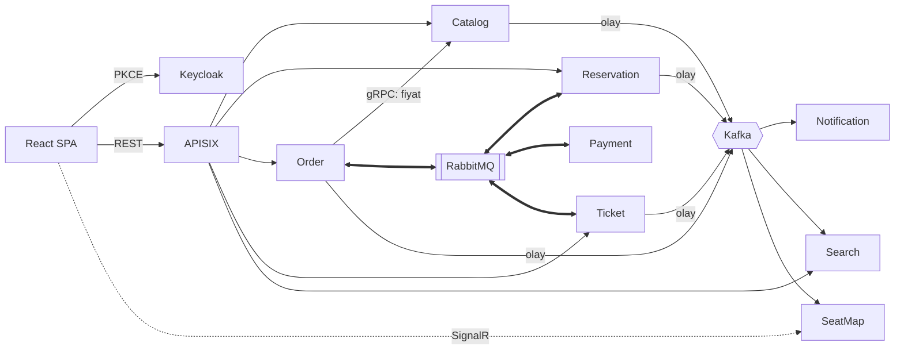
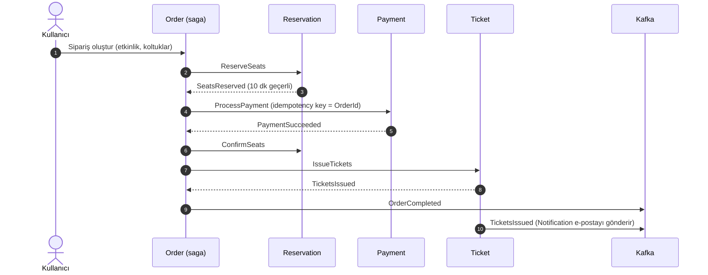
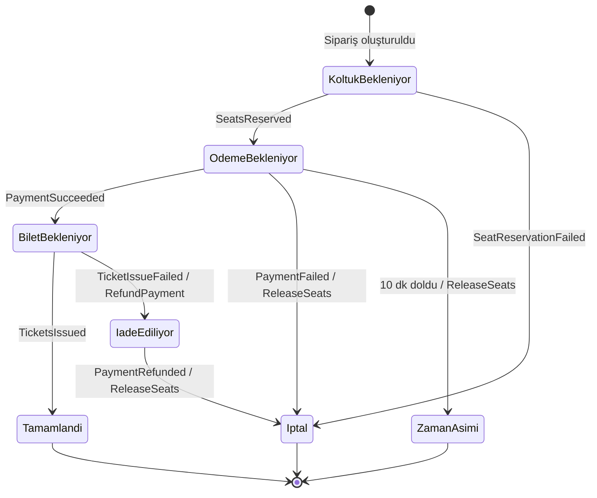

# Gişe — Tasarım Belgesi

> Durum: **Taslak** · Son güncelleme: 2026-10-17

Gişe; konser, tiyatro ve maç gibi etkinlikler için koltuklu bilet satan bir platformdur. Projenin teknik kalbi, satış anında binlerce kişinin aynı koltuklar için yarıştığı durumda **bir koltuğun yalnızca bir kişiye satılmasını** ve ödeme, bilet üretimi gibi adımlardan biri başarısız olduğunda **önceki adımların güvenle geri alınmasını** sağlamaktır.

---

## 1. Hedefler

**Öğrenme hedefleri**
- Saga deseni: orkestrasyon, telafi işlemleri, zaman aşımları
- Yüksek eşzamanlılıkta veri tutarlılığı: süreli koltuk kilidi, idempotency
- İki mesajlaşma modelinin farkı: **kuyruk** (RabbitMQ) ve **olay günlüğü** (Kafka)
- İlk günden test, CI/CD ve canlıya çıkış

**Kapsam dışı (şimdilik)**
- Gerçek ödeme sağlayıcısı (sahte bir sağlayıcı kullanılır)
- Çok dilli arayüz, mobil uygulama
- Etkinlik organizatörü için gelişmiş raporlama

---

## 2. Temel kararlar

| Konu | Karar | Gerekçe |
|---|---|---|
| Servis yapısı | Her servis kendi veritabanına sahip; 5 katman (Domain, Application, Persistence, Infrastructure, Api) | Telgraf'ta oturan yapı |
| Komutlar ve saga | **RabbitMQ + MassTransit** | Kuyruk, yeniden deneme, gecikmeli mesaj ve saga durum makinesi hazır |
| Olay akışı | **Kafka**, **KRaft** modunda (Zookeeper yok) | Olmuş bitmiş gerçekleri birden çok tüketiciye dağıtmak, geriye dönük okuma |
| Güvenilir mesajlaşma | **Kendi yazdığımız outbox ve inbox** (Kafka tarafı) | Desen üzerinde bilerek pratik yapmak; bkz. 2.2 |
| Ödeme | **Test sağlayıcı**; senaryolar test kart numaralarıyla seçilir | Gerçek sağlayıcı kapsam dışı; bkz. 3.2 |
| Gateway | **Apache APISIX** | Bilinen araç; istek sınırı ve route'lar kod olarak tutulur |
| Kimlik | **Keycloak**, SPA'da **PKCE'li authorization code** | Uygulama parolayı görmez (Telgraf'taki password grant dersinden) |
| Servisler arası senkron çağrı | **gRPC** (yalnızca gerektiği yerde) | Tip güvenli, hızlı; ör. Order → Catalog fiyat doğrulama |
| Veri | PostgreSQL (servis başına ayrı veritabanı), Redis, MinIO | |
| Gözlemlenebilirlik | **OpenTelemetry** → Grafana, Tempo, Loki, Prometheus | Elastic Stack'ten hafif ve standart |
| Arayüz | React + Vite | |
| Test | xUnit, MassTransit test harness, **Testcontainers**, k6 | |
| CI/CD | GitHub Actions (ilk günden) | |

### 2.1 RabbitMQ mı, Kafka mı? Kural

İki altyapı bilerek birlikte kullanılıyor. Hangi mesajın nereden gideceği şu kurala göre belirlenir:

| | RabbitMQ (kuyruk) | Kafka (olay günlüğü) |
|---|---|---|
| Mesajın anlamı | **"Şunu yap"** (komut) ya da bir komutun cevabı | **"Şu oldu"** (gerçekleşmiş olay) |
| Kaç alıcı | Bir alıcı | Sıfır ya da çok alıcı; gönderen kimin dinlediğini bilmez |
| Saga'nın parçası mı | Evet | Hayır; saga'nın sonucunu dışarıya duyurur |
| Okunduktan sonra | Silinir | Saklanır; yeni bir tüketici geçmişi baştan okuyabilir |
| Örnek | `ReserveSeats`, `ProcessPayment`, `RefundPayment` | `OrderCompleted`, `TicketsIssued`, `EventPublished` |

**Kısaca:** Bir iş akışını yürüten mesajlar RabbitMQ'dan, sistemin geri kalanına "bu oldu" diyen mesajlar Kafka'dan gider. Bildirim, arama ve koltuk haritası saga'yı **yavaşlatmamalı ve bozmamalı**. Bu yüzden Kafka'yı dinlerler; e-posta gönderilemese bile satış tamamlanmış sayılır.

### 2.2 Outbox ve inbox

Desen bu projede **bilerek iki farklı şekilde** kullanılır:

| | Kafka olayları | RabbitMQ saga mesajları |
|---|---|---|
| Uygulama | **Kendimiz yazarız** | MassTransit'in hazır transactional outbox/inbox'ı |
| Neden | Deseni elle kurup her parçasını anlamak | Aynı desenin bir kütüphanede nasıl yapıldığını görüp karşılaştırmak |

**Outbox (gönderen taraf)**
- İş verisi ile olay **aynı transaction'da** `OutboxMessages` tablosuna yazılır. Olay ya veriyle birlikte kaydedilir ya hiç kaydedilmez.
- Bir arka plan işi bekleyen satırları `FOR UPDATE SKIP LOCKED` ile alır ve Kafka'ya gönderir. Böylece birden fazla kopya aynı satırı iki kez göndermez.
- Başarısız gönderim, artan bekleme süreleriyle yeniden denenir; sınır aşılınca dead-letter olarak işaretlenir ve sağlık kontrolü bunu bildirir.
- Her satır, isteğin trace bilgisini (`traceparent`) taşır; iz Kafka'nın öbür tarafında devam eder.
- İşlenmiş satırlar belli bir süre sonra temizlenir.

**Inbox (alan taraf)**
- Kafka'dan gelen mesaj önce `InboxMessages` tablosuna yazılır. `MessageId` üzerindeki **tekil indeks**, aynı mesaj iki kez gelirse ikincisinin kaydedilmesini engeller.
- Asıl iş (e-posta göndermek, arama dizinini güncellemek) ayrı bir işlemci tarafından yapılır ve başarısız olursa yeniden denenir. Kafka'dan okuma ile işi yapma birbirinden ayrılır.
- Kafka offset'i, mesaj inbox'a yazıldıktan **sonra** onaylanır; arada çökme olursa mesaj yeniden gelir ve inbox tekrarı yakalar.

---

## 3. Servisler

| Servis | Sorumluluk | Veri | Dışarıya açtığı | Gönderdiği | Dinlediği |
|---|---|---|---|---|---|
| **Catalog** | Etkinlik, mekân, salon/koltuk planı, fiyat kategorisi | PostgreSQL | REST (okuma herkese, yazma organizatöre), gRPC (fiyat) | Kafka: `EventPublished`, `EventUpdated` | — |
| **Reservation** | Koltuk tutma (10 dk), kesinleştirme, bırakma; çift satışı önleme | PostgreSQL + Redis | REST (koltuk durumu) | RabbitMQ: `SeatsReserved`, `SeatReservationFailed`; Kafka: `SeatStatusChanged` | RabbitMQ: `ReserveSeats`, `ConfirmSeats`, `ReleaseSeats` |
| **Order** | Satın alma saga'sı (orkestratör) | PostgreSQL (saga durumu) | REST (sipariş oluştur/sorgula) | RabbitMQ: komutlar; Kafka: `OrderCompleted`, `OrderCancelled` | RabbitMQ: komut cevapları |
| **Payment** | Sahte ödeme sağlayıcısı; iade | PostgreSQL | — | RabbitMQ: `PaymentSucceeded`, `PaymentFailed`, `PaymentRefunded` | RabbitMQ: `ProcessPayment`, `RefundPayment` |
| **Ticket** | QR'lı PDF bilet üretimi; kapıda okutma | PostgreSQL + MinIO | REST (biletlerim, kapı okutma) | RabbitMQ: `TicketsIssued`, `TicketIssueFailed`; Kafka: `TicketsIssued`, `TicketCheckedIn` | RabbitMQ: `IssueTickets` |
| **Notification** | E-posta / SMS | PostgreSQL (inbox) | — | — | Kafka: `TicketsIssued`, `OrderCancelled` |
| **Search** | Türkçe tam metin arama, otomatik tamamlama | Elasticsearch | REST | — | Kafka: `EventPublished`, `EventUpdated` |
| **SeatMap** | Koltuk haritasında anlık güncelleme | Redis (backplane) | SignalR | — | Kafka: `SeatStatusChanged` |

### 3.1 Mimari



### 3.2 Test ödeme sağlayıcısı

Payment servisi gerçek bir sağlayıcıya bağlanmaz. Sonuç, kart numarasının son dört hanesine göre belirlenir; böylece testlerde ve elle denemede her senaryo bilerek seçilebilir:

| Kart sonu | Sonuç |
|---|---|
| `0000` | Başarılı |
| `0002` | Reddedildi (yetersiz bakiye) |
| `0005` | Zaman aşımı: yanıt hiç gelmez, saga'nın zaman aşımı devreye girer |
| `0009` | İlk deneme hata verir, yeniden denemede başarılı olur |

İade (`RefundPayment`) her zaman başarılıdır; telafi yolunun kendisini test etmek için ayrıca bir "iade başarısız" kartı eklenebilir.

### 3.3 Catalog: fiyatlar

Fiyat **bölüm başına** belirlenir: her bölümün bir etkinlikte tek fiyatı olur (A Blok 750 ₺, Balkon 400 ₺). Para birimi şimdilik TRY.

- `PUT /api/events/{id}/prices` listeyi bütün olarak ayarlar; listede olmayan bölümün fiyatı kalkar.
- Fiyatı yalnızca etkinliğin sahibi olan organizatör ya da admin belirler. Başka organizatörün etkinliği 403 döner.
- Bölüm, etkinliğin mekânına ait olmalıdır. Fiyat 0'dan büyük, en fazla 1.000.000 ₺ ve en fazla 2 ondalık basamaklı olur.
- Yayındaki etkinliğin fiyatı da değişebilir; satılmış biletler etkilenmez, çünkü Order fiyatı sipariş anında kendine kaydeder. İptal edilmiş etkinliğin fiyatı değişmez.
- **Yayınlama** (`POST /api/events/{id}/publish`): yalnızca sahibi olan organizatör ya da admin; yalnızca taslak ve henüz başlamamış etkinlik. Mekânın **her bölümünün** fiyatı girilmiş olmalıdır, yoksa satılamayan koltuk kalır (422, eksik bölümler `detail`'de). Yayındaki etkinlik tekrar yayınlanamaz (409).
- Yayındaki etkinlikte fiyat değişebilir ama listeden bölüm çıkarılamaz; her bölüm yine fiyatlı kalmalıdır.
- Etkinlik listesi her etkinliğin en düşük fiyatını döndürür (`minPrice`).
- Yayınlanınca Kafka'ya `EventPublished` gitmesi outbox adımında eklenecek.
- Biçim kuralları (fiyat aralığı, ondalık, tekrar eden bölüm) validator'da; veritabanına bakan kurallar (sahiplik, iptal, bölümün mekâna ait olması) `SetEventPricesCommandHandler`'da.

---

## 4. Satın alma saga'sı

Order servisi akışı **yöneten** taraftır (orkestrasyon). Diğer servisler yalnızca kendilerine gelen komutu yapar ve sonucu bildirir; birbirlerini tanımazlar.

### 4.1 Mutlu yol



### 4.2 Durumlar ve telafi



| Başarısız adım | Telafi |
|---|---|
| Koltuk tutulamadı | Yok; sipariş iptal |
| Ödeme başarısız | Koltukları bırak |
| 10 dakikada ödeme gelmedi | Koltukları bırak; sipariş zaman aşımı |
| Bilet üretilemedi | Parayı iade et, ardından koltukları bırak |

**Kurallar**
- Her komut ve cevap **idempotent** işlenir: aynı mesaj iki kez gelirse ikinci kez etkisi olmaz (MassTransit inbox/outbox).
- Zaman aşımı saga'nın kendi zamanlayıcısıyla yönetilir (RabbitMQ gecikmeli mesaj).
- Bir telafi adımı da başarısız olabilir. Bu durumda yeniden denenir, sınır aşılınca saga **"elle müdahale gerekli"** olarak işaretlenir ve uyarı üretilir. Sessizce yutulmaz.

---

## 5. Koltuk tutma ve çift satışı önleme

İki katmanlı yaklaşım:

1. **Redis: hızlı tutma.** Her koltuk için `hold:{etkinlikId}:{koltukId}` anahtarı, `SET NX` ve 10 dakika TTL ile tutulur. Birden fazla koltuk **ya hepsi ya hiçbiri** mantığıyla tek bir Lua betiğiyle tutulur; yarısı tutulmuş bir sepet oluşmaz.
2. **PostgreSQL: kalıcı gerçek.** Satılmış koltuklar Reservation veritabanında tutulur. `(EtkinlikId, KoltukId)` üzerinde, yalnızca satılmışları kapsayan **tekil indeks**, Redis'te bir hata olsa bile aynı koltuğun iki kez satılmasını veritabanı seviyesinde engeller.

**Kanıt:** k6 ile aynı koltuğa aynı anda 1.000 istek gönderilir; tam olarak bir tanesinin başarılı olması beklenir. Bu test CI'da çalışır.

---

## 6. Kimlik ve yetki

| Rol | Yetki |
|---|---|
| `customer` | Etkinlik görme, satın alma, kendi biletleri |
| `organizer` | Kendi etkinliklerini oluşturma ve düzenleme |
| `gate-staff` | Kapıda bilet okutma |
| `admin` | Her şey |

- SPA, Keycloak'a **PKCE'li authorization code** ile bağlanır; parola uygulamadan geçmez.
- Token bellekte tutulur, `localStorage`'a yazılmaz.
- Kimlik işlemlerinin hepsi Keycloak'ta; ayrı bir Identity servisi ve kullanıcı tablosu yok. Servisler kullanıcıyı token'daki `sub` ile tanır (ör. `Event.OrganizerId`).
  - **Kayıt:** "Kayıt ol" düğmesi Keycloak'ın kayıt formunu açar (`prompt=create`). Form ad, soyad ve e-posta ister. E-posta doğrulama açık olduğu için parola, doğrulama bağlantısına tıklandıktan sonra belirlenir; ardından kullanıcı giriş yapmış olarak uygulamaya döner. Yeni kullanıcıya otomatik olarak `customer` rolü verilir.
  - **Parola kuralı:** En az 8 karakter; e-posta ya da kullanıcı adıyla aynı olamaz. Art arda hatalı girişte hesap geçici olarak kilitlenir.
  - **Şifremi unuttum** ve **beni hatırla** giriş sayfasında.
  - **Hesabım:** Keycloak'ın hesap sayfasına gider (`/realms/gise/account`). Profil, parola, aktif oturumlar ve hesap silme burada.
  - **Rol yükseltme:** `organizer` ve `gate-staff` rollerini admin verir; şimdilik Keycloak yönetim panelinden.
- Geliştirmede Keycloak'ın mailleri **Mailpit**'e gider; gerçek e-posta gönderilmez. Gelen kutusu: http://127.0.0.1:8025
- `deploy/keycloak/gise-realm.json` yalnızca ilk açılışta içe aktarılır. Var olan kurulumda realm ayarı değişirse aynı değişiklik yönetim paneli ya da `kcadm.sh` ile de uygulanmalıdır.

---

## 7. Gateway (APISIX)

- Dışarıya açık tek uygulama portu gateway'dir (`localhost:8000`). İstemci de gateway'in arkasından sunulur; tarayıcı tek bir adresle konuşur, CORS gerekmez.
- APISIX **bağımsız (standalone) modda** çalışır: route'lar ve istek sınırları `deploy/apisix/apisix.yaml` dosyasında kod olarak durur. etcd ve yönetim API'si yoktur; dışarıya açık bir yönetim portu da yoktur.
- Satış anında koltuk tutma ucu için IP ve kullanıcı bazlı istek sınırı uygulanır.
- **Telgraf dersi:** APISIX'in DNS önbellek süresi kısa tutulur; aksi halde yeniden başlatılan bir konteynerin eski IP'sine gider.

---

## 8. Gözlemlenebilirlik

- Tüm servisler **OpenTelemetry** ile trace, metrik ve log üretir.
- Tek bir satın alma, RabbitMQ ve Kafka üzerinden geçse bile **tek bir trace** olarak izlenebilmelidir.
- Sağlık uçları: `/health/live`, `/health/ready` (yalnızca vazgeçilmez bağımlılıklar).
- Sağlık yoklamaları trace'e yazılmaz; Cookie ve Authorization başlıkları kaydedilmez.

---

## 9. Test stratejisi

| Seviye | Ne | Araç |
|---|---|---|
| Birim | Domain kuralları, saga durum geçişleri | xUnit, MassTransit test harness |
| Entegrasyon | Her saga başarısızlık yolu, koltuk kilidi, idempotency | Testcontainers (PostgreSQL, Redis, RabbitMQ, Kafka) |
| Yük | Aynı koltuk için eşzamanlı istekler | k6 |
| Duman | Çekirdek stack ayağa kalkıyor, gateway yanıt veriyor | GitHub Actions + Docker Compose |

**Kural:** Saga'nın her adımının ve her geri alma yolunun testi yazılmadan bir sonraki adıma geçilmez.

---

## 10. Proje yapısı

```text
Gişe/
├── docs/                          # tasarım ve kararlar
├── deploy/
│   ├── docker-compose.yml         # name: gise
│   ├── apisix/                    # config.yaml, apisix.yaml (route'lar ve istek sınırları)
│   ├── keycloak/                  # gise-realm.json
│   └── scripts/                   # dev-users.sh
├── src/
│   ├── Shared/
│   │   ├── Gise.Contracts/        # yalnızca servisler arası mesajlar: Commands/, Events/
│   │   └── Gise.Exceptions/       # merkezi hata türleri ve ErrorCodes; her servisin Application'ı kullanır
│   ├── Services/
│   │   ├── Catalog/  Reservation/  Order/  Payment/
│   │   ├── Ticket/   Notification/  Search/  SeatMap/
│   └── Client/                    # React + Vite: api/, auth/, components/, pages/
├── tests/
│   └── Catalog/                   # Gise.Catalog.UnitTests, Gise.Catalog.IntegrationTests
└── Gise.slnx · global.json · Directory.Build.props · Directory.Packages.props
```

Her servis aynı düzendedir:

```text
<Servis>/
├── Core/
│   ├── Gise.<Servis>.Domain/          Common/, Entities/, Enums/
│   └── Gise.<Servis>.Application/     Features/{Commands,Queries,Handlers}/<Varlık>/…,
│                                      Behaviors/, Validators/, Interfaces/, UnitOfWorks/
├── Infrastructure/
│   ├── Gise.<Servis>.Persistence/     Contexts/, Configurations/, Repositories/, UnitOfWorks/, Migrations/
│   └── Gise.<Servis>.Infrastructure/  servise özel: Messaging/, Caching/, Grpc/, Storage/ …
└── Presentation/
    └── Gise.<Servis>.Api/             Controllers/, Authentication/, ErrorHandling/
```

- `Features` düzeni Telgraf'taki gibidir: `Commands/<Varlık>/Request|Response`, `Queries/<Varlık>/Request|Response`, `Handlers/<Varlık>/CommandHandlers|QueryHandlers`.
- Komut ve sorgular Telgraf'taki gibi MediatR (14.1.0) üzerinden gider: controller'lar yalnızca `_mediator.Send(...)` çağırır, handler'lar `IRequestHandler<,>` uygular. Kayıt Application'daki `ServiceRegistration` içindedir (`AddMediatR` + `RegisterServicesFromAssembly`).
- Girdi doğrulaması FluentValidation ile `Application/Behaviors/ValidationBehavior` (`IPipelineBehavior<,>`) içinde, handler'dan önce yapılır; hata `GlobalExceptionHandler`'da 400 ValidationProblemDetails'e çevrilir.
- Entity'ler Telgraf'taki gibi düz sınıflardır: `get; set;` özellikler, kural ve `throw` yok. Doğrulama sınırları (ad uzunlukları, koltuk ve fiyat üst sınırları) appsettings'te durur, ör. Catalog'da `CatalogRules` bölümü; validator'lar `IConfiguration`'dan okur. Sütun boyları EF yapılandırmasında sayı olarak yazılıdır (`HasMaxLength(200)`); appsettings'teki uzunluk sütun boyunu aşmamalıdır, aşarsa veritabanı kaydı reddeder.
- İş kuralları handler'larda uygulanır. Hatalar merkezidir (`src/Shared/Gise.Exceptions`): `AppException` tabanından türeyen `ValidationException` (400), `UnauthorizedException` (401), `ForbiddenException` (403), `NotFoundException` (404), `ConflictException` (409), `BusinessException` (422). Her hata bir `ErrorCode` taşır (`ErrorCodes`); hazır fabrika metotlarıyla atılır, ör. `throw NotFoundException.Event(id)`.
- `GlobalExceptionHandler` her `AppException`'ı aynı biçimde ProblemDetails'e çevirir: `title` = mesaj, `detail` = açıklama, `errorCode` = kod. Tanınmayan hata 500 olur ve loglanır.
- Hatalar RFC 7807 **ProblemDetails** biçiminde ve Türkçe döner.
- Payment ve Notification'ın dışarıya açık API'si yoktur. SeatMap controller yerine SignalR **hub**'ı (`Hubs/`) kullanır.

Kodda ve konteyner adlarında ASCII **`gise`** kullanılır; klasör adındaki `ş` bazı araçlarda sorun çıkarabiliyor.

---

## 11. Telgraf'tan alınan dersler (baştan uygulanacak)

- Kafka, PostgreSQL ve Redis için kalıcı volume; Kafka'da replikasyon ayarı bilinçli seçilir.
- Dışarıya yalnızca gateway ve Keycloak açılır; veritabanı, Redis, RabbitMQ ve Kafka portları açılmaz.
- Parolalar repoda durmaz; `.env.example` yalnızca değişken adlarını içerir.
- Migration'lar servis açılırken uygulanır. Telgraf'ta birden fazla kopyanın aynı anda migration çalıştırması bir riskti; EF Core 9'dan beri migration sırasında veritabanında kilit alındığı için kopyalar sırayla bekler.
- Outbox okuyan worker'lar `FOR UPDATE SKIP LOCKED` ile birden fazla kopyada güvenle çalışır.
- Servislerin `Production` modu ilk günden denenir.

---

## 12. Aşamalar

| # | Aşama | Bitti sayılması için |
|---|---|---|
| 0 | **İskelet** | Solution, Catalog'dan tek uç nokta, APISIX, Keycloak (PKCE) ile giriş yapan boş React sayfası, GitHub Actions'ta build ve test |
| 1 | **Catalog** (+ Search) | Etkinlik oluşturma, listeleme, arama. **İlk outbox:** `EventPublished` outbox üzerinden Kafka'ya gider; Search onu **ilk inbox** ile alır |
| 2 | **Reservation** | Koltuk tutma ve bırakma; k6 yarış testi CI'da yeşil |
| 3 | **Order + Payment** | Saga'nın tüm yolları; her başarısızlık yolu için entegrasyon testi |
| 4 | **Ticket + Notification** | QR'lı PDF bilet, kapıda okutma, e-posta |
| 5 | **SeatMap + gözlemlenebilirlik** | Anlık koltuk haritası; uçtan uca tek trace |
| 6 | **Canlıya çıkış** | Sunucuda HTTPS ile çalışan sistem, otomatik dağıtım |

---

## 13. Açık sorular

1. **MassTransit sürümü ve lisansı:** v8 açık kaynak; sonraki ana sürüm ticari lisansa geçti. Hangi sürümün kullanılacağı 3. aşamadan önce güncel lisans durumuna bakılarak seçilmeli.

**Karara bağlananlar (2026-10-17):** Kafka olayları için kendi outbox/inbox'ımız yazılır ve entity'leri her servisin kendi içinde durur; Kafka KRaft modunda çalışır; ödeme test sağlayıcıyla yapılır (bkz. 3.2).
