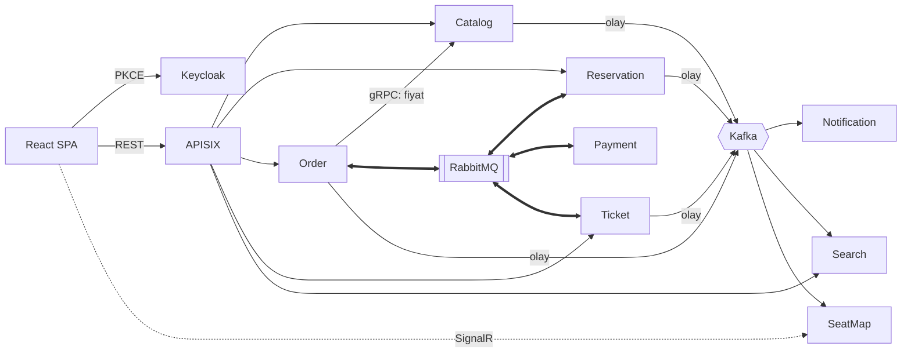
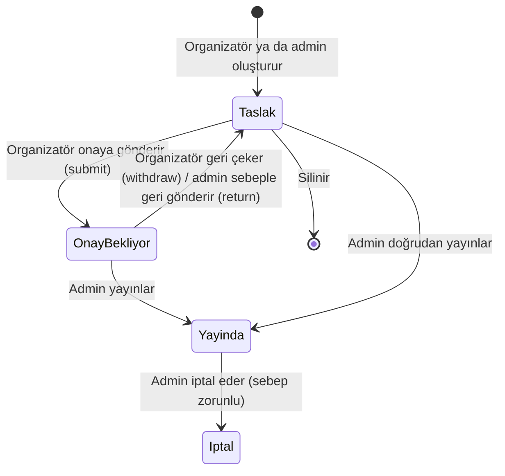
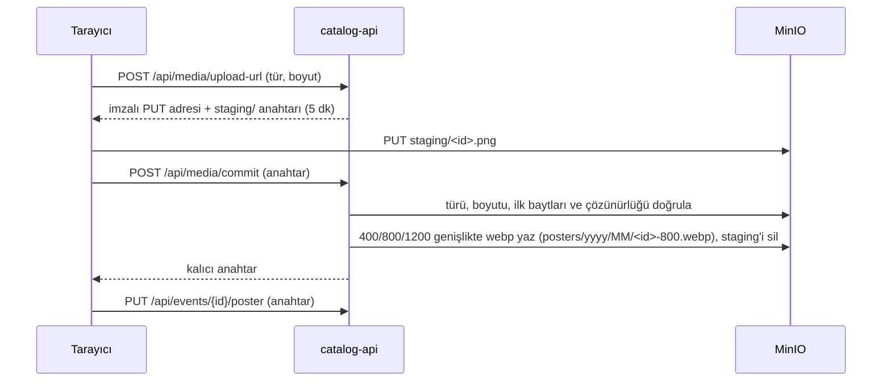
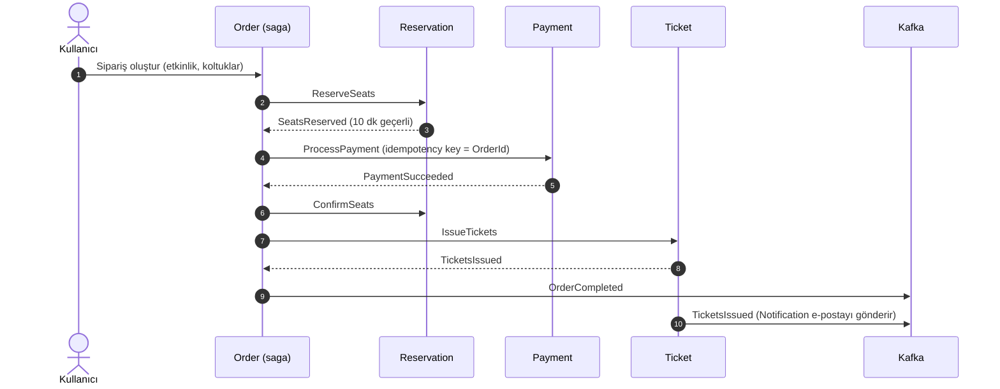
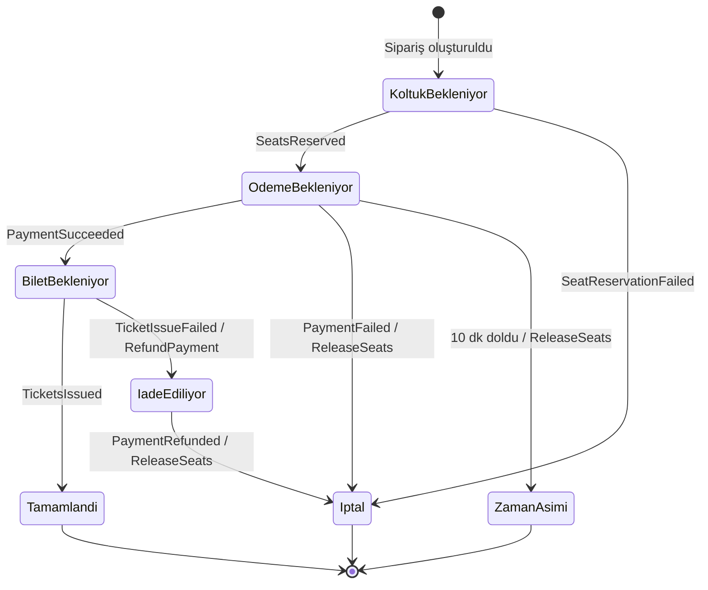

# Gişe — Tasarım Belgesi

> Durum: **Taslak** · Son güncelleme: 2026-10-17

Gişe; konser, tiyatro ve maç gibi etkinlikler için koltuklu bilet satan bir platformdur. Projenin teknik kalbi, satış anında binlerce kişinin aynı koltuklar için yarıştığı durumda **bir koltuğun yalnızca bir kişiye satılmasını** ve ödeme, bilet üretimi gibi adımlardan biri başarısız olduğunda **önceki adımların güvenle geri alınmasını** sağlamaktır.

---

## 1. Hedefler

**Öğrenme hedefleri**
- Saga deseni: orkestrasyon, telafi işlemleri, zaman aşımları
- Yüksek eşzamanlılıkta veri tutarlılığı: süreli koltuk kilidi, idempotency
- İki mesajlaşma modelinin farkı: **kuyruk** (RabbitMQ) ve **olay günlüğü** (Kafka)
- İlk günden test, CI/CD ve canlıya çıkış

**Kapsam dışı (şimdilik)**
- Gerçek ödeme sağlayıcısı (sahte bir sağlayıcı kullanılır)
- Çok dilli arayüz, mobil uygulama
- Etkinlik organizatörü için gelişmiş raporlama

---

## 2. Temel kararlar

| Konu | Karar | Gerekçe |
|---|---|---|
| Servis yapısı | Her servis kendi veritabanına sahip; 5 katman (Domain, Application, Persistence, Infrastructure, Api) | Telgraf'ta oturan yapı |
| Komutlar ve saga | **RabbitMQ + MassTransit** | Kuyruk, yeniden deneme, gecikmeli mesaj ve saga durum makinesi hazır |
| Olay akışı | **Kafka**, **KRaft** modunda (Zookeeper yok) | Olmuş bitmiş gerçekleri birden çok tüketiciye dağıtmak, geriye dönük okuma |
| Güvenilir mesajlaşma | **Kendi yazdığımız outbox ve inbox** (Kafka tarafı) | Desen üzerinde bilerek pratik yapmak; bkz. 2.2 |
| Ödeme | **Test sağlayıcı**; senaryolar test kart numaralarıyla seçilir | Gerçek sağlayıcı kapsam dışı; bkz. 3.2 |
| Gateway | **Apache APISIX** | Bilinen araç; istek sınırı ve route'lar kod olarak tutulur |
| Kimlik | **Keycloak**, SPA'da **PKCE'li authorization code** | Uygulama parolayı görmez (Telgraf'taki password grant dersinden) |
| Servisler arası senkron çağrı | **gRPC** (yalnızca gerektiği yerde) | Tip güvenli, hızlı; ör. Order → Catalog fiyat doğrulama |
| Veri | PostgreSQL (servis başına ayrı veritabanı), Redis, MinIO | |
| Gözlemlenebilirlik | **OpenTelemetry** → Grafana, Tempo, Loki, Prometheus | Elastic Stack'ten hafif ve standart |
| Arayüz | React + Vite | |
| Test | xUnit, MassTransit test harness, **Testcontainers**, k6 | |
| CI/CD | GitHub Actions (ilk günden) | |

### 2.1 RabbitMQ mı, Kafka mı? Kural

İki altyapı bilerek birlikte kullanılıyor. Hangi mesajın nereden gideceği şu kurala göre belirlenir:

| | RabbitMQ (kuyruk) | Kafka (olay günlüğü) |
|---|---|---|
| Mesajın anlamı | **"Şunu yap"** (komut) ya da bir komutun cevabı | **"Şu oldu"** (gerçekleşmiş olay) |
| Kaç alıcı | Bir alıcı | Sıfır ya da çok alıcı; gönderen kimin dinlediğini bilmez |
| Saga'nın parçası mı | Evet | Hayır; saga'nın sonucunu dışarıya duyurur |
| Okunduktan sonra | Silinir | Saklanır; yeni bir tüketici geçmişi baştan okuyabilir |
| Örnek | `ReserveSeats`, `ProcessPayment`, `RefundPayment` | `OrderCompleted`, `TicketsIssued`, `EventPublished` |

**Kısaca:** Bir iş akışını yürüten mesajlar RabbitMQ'dan, sistemin geri kalanına "bu oldu" diyen mesajlar Kafka'dan gider. Bildirim, arama ve koltuk haritası saga'yı **yavaşlatmamalı ve bozmamalı**. Bu yüzden Kafka'yı dinlerler; e-posta gönderilemese bile satış tamamlanmış sayılır.

### 2.2 Outbox ve inbox

Desen bu projede **bilerek iki farklı şekilde** kullanılır:

| | Kafka olayları | RabbitMQ saga mesajları |
|---|---|---|
| Uygulama | **Kendimiz yazarız** | MassTransit'in hazır transactional outbox/inbox'ı |
| Neden | Deseni elle kurup her parçasını anlamak | Aynı desenin bir kütüphanede nasıl yapıldığını görüp karşılaştırmak |

**Outbox (gönderen taraf)**
- İş verisi ile olay **aynı transaction'da** `OutboxMessages` tablosuna yazılır. Olay ya veriyle birlikte kaydedilir ya hiç kaydedilmez.
- Bir arka plan işi bekleyen satırları `FOR UPDATE SKIP LOCKED` ile alır ve Kafka'ya gönderir. Böylece birden fazla kopya aynı satırı iki kez göndermez.
- Başarısız gönderim, artan bekleme süreleriyle yeniden denenir; sınır aşılınca dead-letter olarak işaretlenir ve sağlık kontrolü bunu bildirir.
- Her satır, isteğin trace bilgisini (`traceparent`) taşır; iz Kafka'nın öbür tarafında devam eder.
- İşlenmiş satırlar belli bir süre sonra temizlenir.

**Inbox (alan taraf)**
- Kafka'dan gelen mesaj önce `InboxMessages` tablosuna yazılır. `MessageId` üzerindeki **tekil indeks**, aynı mesaj iki kez gelirse ikincisinin kaydedilmesini engeller.
- Asıl iş (e-posta göndermek, arama dizinini güncellemek) ayrı bir işlemci tarafından yapılır ve başarısız olursa yeniden denenir. Kafka'dan okuma ile işi yapma birbirinden ayrılır.
- Kafka offset'i, mesaj inbox'a yazıldıktan **sonra** onaylanır; arada çökme olursa mesaj yeniden gelir ve inbox tekrarı yakalar.

---

## 3. Servisler

| Servis | Sorumluluk | Veri | Dışarıya açtığı | Gönderdiği | Dinlediği |
|---|---|---|---|---|---|
| **Catalog** | Etkinlik, mekân, salon/koltuk planı, fiyat kategorisi, afiş | PostgreSQL + MinIO (afişler) | REST (okuma herkese; taslak organizatöre, yayın ve iptal admin'e), gRPC (koltuk ve fiyat) | Kafka: `EventPublished`, `EventUpdated`, `EventCancelled` | — |
| **Reservation** | Koltuk tutma (10 dk), kesinleştirme, bırakma; çift satışı önleme | PostgreSQL + Redis | REST (koltuk durumu) | RabbitMQ: `SeatsReserved`, `SeatReservationFailed`; Kafka: `SeatStatusChanged` | RabbitMQ: `ReserveSeats`, `ConfirmSeats`, `ReleaseSeats`; Kafka: `EventPublished`, `EventUpdated`, `EventCancelled` |
| **Order** | Satın alma saga'sı (orkestratör) | PostgreSQL (saga durumu) | REST (sipariş oluştur/sorgula) | RabbitMQ: komutlar; Kafka: `OrderCompleted`, `OrderCancelled` | RabbitMQ: komut cevapları; Kafka: `EventCancelled`, `EventUpdated` |
| **Payment** | Sahte ödeme sağlayıcısı; iade | PostgreSQL | — | RabbitMQ: `PaymentSucceeded`, `PaymentFailed`, `PaymentRefunded` | RabbitMQ: `ProcessPayment`, `RefundPayment` |
| **Ticket** | QR'lı PDF bilet üretimi; kapıda okutma | PostgreSQL + MinIO | REST (biletlerim, kapı okutma) | RabbitMQ: `TicketsIssued`, `TicketIssueFailed`; Kafka: `TicketsIssued`, `TicketCheckedIn` | RabbitMQ: `IssueTickets`; Kafka: `EventCancelled` |
| **Notification** | E-posta / SMS | PostgreSQL (inbox) | — | — | Kafka: `TicketsIssued`, `OrderCancelled`, `EventCancelled`, `EventUpdated` |
| **Search** | Türkçe tam metin arama, otomatik tamamlama | Elasticsearch | REST | — | Kafka: `EventPublished`, `EventUpdated`, `EventCancelled` |
| **SeatMap** | Koltuk haritasında anlık güncelleme | Redis (backplane) | SignalR | — | Kafka: `SeatStatusChanged` |

### 3.1 Mimari



### 3.2 Test ödeme sağlayıcısı

Payment servisi gerçek bir sağlayıcıya bağlanmaz. Sonuç, kart numarasının son dört hanesine göre belirlenir; böylece testlerde ve elle denemede her senaryo bilerek seçilebilir:

| Kart sonu | Sonuç |
|---|---|
| `0000` | Başarılı |
| `0002` | Reddedildi (yetersiz bakiye) |
| `0005` | Zaman aşımı: yanıt hiç gelmez, saga'nın zaman aşımı devreye girer |
| `0009` | İlk deneme hata verir, yeniden denemede başarılı olur |

İade (`RefundPayment`) her zaman başarılıdır; telafi yolunun kendisini test etmek için ayrıca bir "iade başarısız" kartı eklenebilir.

### 3.3 Catalog: fiyatlar

Fiyat **bölüm başına** belirlenir: her bölümün bir etkinlikte tek fiyatı olur (A Blok 750 ₺, Balkon 400 ₺). Para birimi şimdilik TRY.

- `PUT /api/events/{id}/prices` listeyi bütün olarak ayarlar; listede olmayan bölümün fiyatı kalkar.
- Taslağın fiyatını sahibi olan organizatör ya da admin, yayındakinin fiyatını yalnızca admin belirler (bkz. 3.4).
- Bölüm, etkinliğin mekânına ait olmalıdır. Fiyat 0'dan büyük, en fazla 1.000.000 ₺ ve en fazla 2 ondalık basamaklı olur.
- Yayındaki etkinliğin fiyatı da değişebilir; yalnızca bundan sonraki satışları etkiler. Satılmış biletler için fark iadesi ya da ek ücret olmaz, çünkü Order fiyatı sipariş anında kendine kaydeder. Reservation fiyatları yayın anında gRPC ile alır; `EventUpdated` gelince yeniden okumalıdır.
- **Yayınlama** (`POST /api/events/{id}/publish`): yalnızca admin; taslak ya da onay bekleyen, henüz başlamamış etkinlik. Mekânın **her bölümünün** fiyatı girilmiş olmalıdır, yoksa satılamayan koltuk kalır (422, eksik bölümler `detail`'de). Yayındaki etkinlik tekrar yayınlanamaz (409).
- Yayındaki etkinlikte fiyat değişebilir ama listeden bölüm çıkarılamaz; her bölüm yine fiyatlı kalmalıdır.
- **Taslak görünürlüğü:** Taslak ve onay bekleyen etkinliğin detayını (`GET /api/events/{id}`) yalnızca sahibi olan organizatör ve admin görür; diğer herkes 404 alır. 403 dönülmez, çünkü etkinliğin var olduğunu ele verirdi. Liste ve gRPC zaten yalnızca yayındaki etkinlikleri döndürür.
- Etkinlik listesi her etkinliğin en düşük fiyatını döndürür (`minPrice`).
- `GET /api/events/mine`: organizatörün kendi etkinlikleri, taslaklar dahil. Ön yüzde "Etkinliklerim" sayfası bunu kullanır; fiyat girme, onaya gönderme ve yayınlama etkinlik detay sayfasındadır.
- Yayınlanınca `EventPublished` olayı aynı transaction'da outbox'a yazılır (bkz. 3.5).

### 3.4 Catalog: mekân ve etkinlik yönetimi

**Mekân** (yalnızca admin; ön yüzde "Mekânlar" sayfası):

- `PUT /api/venues/{id}`: ad ve şehir her zaman değişir.
- `PUT /api/venues/{id}/layout`: bölüm düzeni yalnızca mekânda **hiç etkinlik yokken** (taslak dahil) değişir; varsa 422 `VENUE_HAS_EVENTS`. Fiyatlar ve Reservation'ın koltuk stoğu bölümlere bağlıdır.
- `DELETE /api/venues/{id}`: yalnızca etkinliği olmayan mekân silinir (aynı kural).

**Etkinlik:** organizatör taslak hazırlar ve onaya gönderir; yayınlama, yayındaki etkinliği değiştirme ve iptal admin'in işidir. Durumlar: **Taslak → Onay bekliyor → Yayında → İptal**.



| | Taslak | Onay bekliyor | Yayında | İptal |
|---|---|---|---|---|
| Ad, tarih (`PUT /api/events/{id}`) | Sahibi, admin | Kimse (422 `EVENT_IN_REVIEW`) | Yalnızca admin (organizatöre 403 `EVENT_ADMIN_ONLY`); `EventUpdated` gider | Kimse |
| Mekân | Sahibi, admin; fiyatlar silinir | Kimse | Kimse (422 `EVENT_VENUE_LOCKED`): koltuk stoğu mekâna bağlı | Kimse |
| Fiyat (`PUT .../prices`) | Sahibi, admin | Kimse | Yalnızca admin; `EventUpdated` gider | Kimse |
| Afiş (`PUT .../poster`) | Sahibi, admin | Kimse | Yalnızca admin | Kimse |
| Onaya gönder (`POST .../submit`) | Sahibi, admin; her bölüm fiyatlı olmalı | — | — | — |
| Geri çek (`POST .../withdraw`) | — | Sahibi, admin | — | — |
| Geri gönder (`POST .../return`, sebep zorunlu) | — | Yalnızca admin | — | — |
| Yayınla (`POST .../publish`) | Yalnızca admin | Yalnızca admin | 409 | — |
| Sil (`DELETE /api/events/{id}`) | Sahibi, admin | Önce geri çekilir | Silinmez; iptal edilir | Silinmez |
| İptal (`POST .../cancel`) | Edilmez, silinir | Edilmez | Yalnızca admin; `EventCancelled` gider | Tekrar edilmez |

- Başka organizatörün etkinliği 403 `EVENT_NOT_OWNER`.
- Admin'in geri gönderme sebebi taslakta organizatöre gösterilir; yeniden gönderince ya da yayınlanınca silinir.
- `GET /api/events/pending` (yalnızca admin): tüm organizatörlerin onay bekleyen etkinlikleri. Ön yüzde "Onay bekleyenler" sayfası.
- Onaya gönderme ve geri çekme olay üretmez; onay bekleyen etkinliği başka servis bilmez.
- Başlamış ya da geçmiş etkinlikte hiçbir değişiklik yapılmaz (422 `EVENT_ALREADY_STARTED`).
- İptal **geri alınamaz** ve sebep zorunludur (en fazla 500 karakter). İptal edilen etkinlik genel listeden kalkar; detay sayfası herkese açık kalır ve "iptal edildi" uyarısını tarih ve sebeple gösterir. Organizatörün "Etkinliklerim" sayfasında "İptal" rozetiyle görünür.
- Taslağı başka servis bilmediği için taslaktaki değişiklik ve silme olay üretmez.
- Ad ya da tarih aynı kalırsa (yalnızca kaydet'e basıldıysa) `EventUpdated` gönderilmez.
- Ön yüzde hepsi etkinlik detay sayfasının "Yönetim" bölümündedir; kullanıcı yalnızca rolüne ve duruma göre yapabildiklerini görür. Silme ve iptal tarayıcı onayı ister.

### 3.5 Catalog: olaylar ve gRPC

- **`EventPublished`** (`Gise.Contracts/Events`) küçük bir olaydır: etkinlik, mekân, başlık, tarih, mekân adı, şehir ve en düşük fiyat. Koltuk listesi olayda **yoktur**; her servis kendi ihtiyacını Catalog'a sorar.
- **`EventUpdated`** aynı alanları ve `PreviousStartsAt`'i taşır: Search kaydını günceller, tarih değiştiyse bilet sahiplerine bildirim bununla gidebilir.
- **`EventCancelled`**: etkinlik, sebep ve iptal zamanı. Reservation satışı durduracak, Order ve Payment iade başlatacak.
- Olayları `IOutboxMessageRepository.AddCatalogEventAsync` yazar: `Type` olayın sınıf adı, anahtar etkinlik ID'si.
- Olaylar `catalog.events` topic'ine gider. Anahtar etkinlik ID'sidir, böylece aynı etkinliğin olayları aynı bölüme düşer ve sırası korunur. Başlıklar: `type` (ör. `EventPublished`), `message-id` (alan tarafın inbox'ı tekrarı bununla yakalar), `traceparent`.
- **`catalog-outbox-worker`** (`src/Workers/Gise.Catalog.OutboxWorker`), Telgraf'taki outbox worker'lar gibi catalog-api'den **ayrı bir process**: API çökse de bekleyen olaylar gönderilmeye devam eder. Kendi `OutboxWorkerDbContext`'i yalnızca outbox tablosunu görür; tabloyu catalog-api'nin migration'ları kurar. Birkaç saniyede bir bekleyen satırları `FOR UPDATE SKIP LOCKED` ile alıp gönderir; aynı anahtarın daha eski bir olayı beklerken yenisi onu geçmez. Gönderilemeyen satır artan aralıklarla (en fazla 5 dk) yeniden denenir; `MaxRetryCount` aşılınca dead-letter olur. Gönderilmiş satırlar `RetentionDays` sonra silinir. Ayarlar worker'ın appsettings'inde: `Kafka` ve `Outbox` bölümleri.
- Worker'ın `/health/ready` ucu: döngü dönüyor mu (heartbeat, `src/Shared/Gise.HealthChecks`), Postgres erişilebilir mi, dead-letter var mı (varsa "Degraded").
- Topic'i olayı yayan servis açılışta oluşturur; Kafka'da otomatik oluşturma kapalıdır.
- **gRPC** (`Gise.Contracts/Protos/catalog.proto`): `GetEventSeats(event_id)` yayındaki etkinliğin koltuklarını bölüm, sıra, numara ve kuruş cinsinden fiyatla döndürür. Reservation, `EventPublished` gelince stoğu bununla kurar. Catalog bunu yalnızca **8081** portunda (HTTP/2) sunar; bu port Docker ağının dışına ve gateway'e açık değildir. Hatalar gRPC durum koduna çevrilir: 404 → `NotFound`, iş kuralı → `FailedPrecondition`; `error-code` başlığı merkezi hata kodunu taşır.
- Servisler arası kimlik doğrulama (Keycloak servis token'ı) henüz yok.
- Biçim kuralları (fiyat aralığı, ondalık, tekrar eden bölüm) validator'da; veritabanına bakan kurallar (sahiplik, iptal, bölümün mekâna ait olması) `SetEventPricesCommandHandler`'da.


### 3.6 Catalog: afişler

Telgraf'taki görsel yüklemeyle aynı akış. Dosya API'den geçmez; tarayıcı MinIO'ya doğrudan yükler.



- **Kurallar** (`Storage` bölümü, appsettings): JPEG, PNG, WebP, AVIF; en fazla 5 MB ve 40 megapiksel. Küçük bir dosyanın çok büyük bir görüntüye açılıp belleği doldurması bu sınırla önlenir. Tür beyana değil dosyanın ilk baytlarına göre doğrulanır; uymayan dosya silinir.
- Boyutlandırma **SkiaSharp** ile (MIT). Telgraf'taki ImageSharp'ın 4.1.2 öncesi sürümlerinde görsel çözmede bilinen açıklar var; sonraki sürümler lisans anahtarı istiyor.
- **Bucket** `gise-media`: yalnızca `posters/` herkese açık okunur (her görüntüleme için imzalı adres üretmek tarayıcı önbelleğini bozardı). `staging/` açık değildir ve 1 gün sonra silinir. Kurulum: `docker compose -f deploy/docker-compose.yml --profile setup up minio-init` (`deploy/minio/setup.sh`, tekrar çalıştırılabilir).
- MinIO'nun API portu (9000) yalnızca `127.0.0.1`'e açık; CORS yalnızca `http://localhost:8000`'e izin verir.
- Etkinlik yalnızca anahtarı tutar (`PosterKey`); yanıtlar `posterUrl` (800'lük boy) ve `posterSrcset` döndürür, tarayıcı ekrana uyan boyu seçer. Afiş yoksa ön yüz renkli yer tutucuyu çizer.
- Afiş bilgi ve fiyatla aynı yetki kurallarına tabidir (bkz. 3.4).
- **Henüz yok:**
  - Değiştirilen ya da kaldırılan afişin eski dosyaları silinmiyor.
  - Olaylar (`EventPublished`, `EventUpdated`) afiş taşımıyor; Search yazılırken eklenecek.
  - Uygulama MinIO'ya kök kullanıcıyla bağlanıyor (Telgraf'taki gibi); canlıda yalnızca bu bucket'a yetkili ayrı bir kullanıcı olmalı.


### 3.7 Reservation: koltuk stoğu

Reservation, Catalog'un olaylarını Kafka'dan alır ve her yayındaki etkinlik için kendi koltuk stoğunu tutar. Koltuk haritası ve satış Catalog'a sormadan çalışır. Inbox, Telgraf'taki gibi iki parçalıdır:

- **Tüketici** (`Gise.Reservation.Infrastructure/Consumers/CatalogEventsConsumer`): reservation-api içinde çalışan bir `BackgroundService`. `catalog.events`'ten okur, mesajı `message-id` başlığıyla `inbox_messages`'a yazar (aynı mesaj ikinci kez yazılmaz), sonra offset'i onaylar. Yazamazsa okuma konumunu geri sarar; mesaj atlanmaz.
- **Worker** (`src/Workers/Gise.Reservation.InboxWorker`, compose'da `reservation-inbox-worker`): ayrı process. Inbox'ı işler:
  - Aynı etkinliğin olayları geldiği sırayla işlenir; birden çok kopya `FOR UPDATE SKIP LOCKED` ile çakışmaz.
  - Her mesaj kendi transaction'ında işlenir; hata olursa yarım değişiklik geri alınır, artan aralıklarla yeniden denenir, `MaxRetryCount` aşılınca dead-letter olur.
  - Sağlık: heartbeat, Postgres, dead-letter (`/health/ready`).

| Olay | Reservation'da |
|---|---|
| `EventPublished` | Koltuklar Catalog'dan gRPC ile alınır (`GetEventSeats`); stok kurulur: bölüm, sıra, numara ve fiyatın kopyası. Olay ikinci kez gelirse stok zaten vardır. Etkinlik bu arada iptal edildiyse stok iptal olarak açılır. |
| `EventUpdated` | Tarih güncellenir; olay yalnızca en düşük fiyatı taşıdığı için bölüm fiyatları Catalog'dan yeniden okunur. |
| `EventCancelled` | Satış kapanır (`CancelledAt`); tutulan koltuklar bırakılır. Satılmış koltukların iadesi Order'ın işi (bkz. 4.4). |

- `GET /api/reservation/events/{id}/seats` (herkese açık): bölümler, bölüm fiyatı, boş koltuk sayısı ve her koltuğun boş olup olmadığı. Tutulmuş ya da satılmış ayrımı dışarı verilmez. Stok yoksa 404 `STOCK_NOT_FOUND` (etkinlik yayında değil ya da worker henüz kurmadı). `/api/events` Catalog'un olduğu için Reservation'ın uçları gateway'de `/api/reservation` altında.
- Koltuk haritasında "boş" = satılmamış ve şu an tutulmuyor (Redis'e bakılır, bkz. 5).
- **Henüz yok:** satış (`ConfirmSeats`, Payment ile gelecek). gRPC çağrısında servisler arası kimlik doğrulama yok.

---

## 4. Satın alma saga'sı

Order servisi akışı **yöneten** taraftır (orkestrasyon). Diğer servisler yalnızca kendilerine gelen komutu yapar ve sonucu bildirir; birbirlerini tanımazlar.

### 4.1 Mutlu yol



### 4.2 Durumlar ve telafi



| Başarısız adım | Telafi |
|---|---|
| Koltuk tutulamadı | Yok; sipariş iptal |
| Ödeme başarısız | Koltukları bırak |
| 10 dakikada ödeme gelmedi | Koltukları bırak; sipariş zaman aşımı |
| Bilet üretilemedi | Parayı iade et, ardından koltukları bırak |

**Kurallar**
- Her komut ve cevap **idempotent** işlenir: aynı mesaj iki kez gelirse ikinci kez etkisi olmaz (MassTransit inbox/outbox).
- Zaman aşımı saga'nın kendi zamanlayıcısıyla yönetilir (MassTransit + Quartz, bkz. 4.3). RabbitMQ'nun gecikmeli mesaj eklentisi kullanılmaz: arşivlendi ve RabbitMQ 4.3'te çalışmıyor (dayandığı Mnesia kaldırıldı).
- Bir telafi adımı da başarısız olabilir. Bu durumda yeniden denenir, sınır aşılınca saga **"elle müdahale gerekli"** olarak işaretlenir ve uyarı üretilir. Sessizce yutulmaz.

### 4.3 Uygulama (Order + Reservation)

Saga'nın koltuk tutma kısmı yazıldı; ödeme (Payment) ve bilet (Ticket) adımları sonra eklenecek.

- **MassTransit 8.5.x** (Apache-2.0). Saga durum makinesi `OrderStateMachine` (`Gise.Order.Application/Sagas`); durumu `order_state` tablosunda. Müşterinin gördüğü sipariş (`orders`) her adımda saga ile aynı transaction'da güncellenir.
- **Uçlar** (giriş yapmış müşteri; gateway'de `/api/orders`):
  - `POST` (etkinlik, koltuklar) → 202 ve siparişin ID'si; durum `Pending`. Koltuklar arkada tutulur, sonucu `GET {id}` gösterir.
  - `GET {id}` (sahibi ve admin), `GET mine`.
  - `POST {id}/cancel`: yalnızca `AwaitingPayment` iken (değilse 422 `ORDER_NOT_CANCELLABLE`).
- **Akış:**
  - Sipariş açılınca `OrderSubmitted` siparişle aynı transaction'da outbox'a yazılır; saga `ReserveSeats` komutunu `reserve-seats` kuyruğuna gönderir.
  - Reservation `SeatsReserved` ile cevap verirse sipariş `AwaitingPayment` olur; koltuklar ve fiyatlar siparişe kopyalanır. Ödeme süresi tutmanın bitişine eşitlenir.
  - `SeatReservationFailed` gelirse sipariş sebebiyle `Cancelled` olur (koltuk dolu, etkinlik satışta değil, aynı etkinlikte ödemesi bekleyen başka sipariş var).
  - Müşteri vazgeçerse ya da süre dolarsa `ReleaseSeats` gönderilir; sipariş `Cancelled` ya da `Expired` olur.
  - Reservation hiç cevap vermezse sipariş açılışta kurulan zaman aşımıyla `Expired` olur ("Koltuklar zamanında tutulamadı"); saga yine de `ReleaseSeats` gönderir.
  - Kapanan saga'nın satırı silinir, sipariş geçmiş olarak kalır. Kapandıktan sonra gelen geç cevaplar yok sayılır.
- **Zaman aşımı:** MassTransit + Quartz; planlanan mesajlar Order veritabanındaki `qrtz_*` tablolarında (migration `AddQuartzTables`), order-api yeniden başlasa da kaybolmaz. Kümelenme açık; her kopya kendi kimliğini alır.
- **Güvenilirlik:** iki tarafta da MassTransit'in EF Core inbox/outbox'ı (`inbox_state`, `outbox_message`, `outbox_state`); Kafka tarafındaki kendi outbox/inbox'ımızdan ayrı tablolar. Geçici hatalar 1, 5, 15 sn aralıkla yeniden denenir, sonra `_error` kuyruğuna düşer.
- **Tekrar ve sıra:**
  - Tutmanın ID'si siparişin ID'sidir: `ReserveSeats` yeniden gelirse Lua betiği kendi kilidini tanır, var olan tutma döner.
  - `ReserveSeats` ve `ReleaseSeats` ayrı kuyruklarda olduğu için sıraları garanti değildir. "Bırak" önce gelirse sipariş için "bırakıldı" kaydı yazılır; sonradan gelen "tut" koltuk tutmaz (`HOLD_ORDER_CLOSED`).
- **Ayarlar:** `OrderRules` (ödeme süresi 10 dk, siparişte en fazla 10 koltuk), `RabbitMq`.
- **Denendi:** başarılı sipariş, dolu koltuk, aynı etkinlikte ikinci sipariş, yetki, vazgeçme, ödeme süresinin dolması ve Reservation kapalıyken siparişin askıda kalmaması (süreler test için 1 dakikaya indirilerek).

### 4.4 Etkinlik iptal edilince ve tarihi değişince

Catalog `EventCancelled` ve `EventUpdated` olaylarını Kafka'ya gönderir (bkz. 3.5). Bilet sahiplerini ilgilendiren işler bu olayları dinleyen servislerde yapılır; bu servisler yazılırken uygulanacak.

**İptal (`EventCancelled`): tam iade, otomatik.** Kullanıcının bir şey yapması gerekmez.

1. **Reservation** satışı hemen durdurur: yeni `ReserveSeats` reddedilir, tutulan koltuklar bırakılır.
2. **Order** iptal edilen etkinlikleri kendi tarafında tutar ve:
   - tamamlanmış her sipariş için iade başlatır (`RefundPayment` → `PaymentRefunded`); sipariş "İade edildi" olur;
   - ödemesi süren siparişi iptal eder; ödeme iptalden sonra gelirse onu da hemen iade eder;
   - bu etkinlik için yeni sipariş açmaz.
3. **Payment** kesintisiz tam iade yapar.
4. **Ticket** biletleri geçersiz yapar; kapıda okutulunca reddedilir.
5. **Notification** her bilet sahibine iptal sebebi ve iade bilgisiyle e-posta gönderir.

**Tarih değişikliği (`EventUpdated`, `PreviousStartsAt` farklıysa):**

- Biletler yeni tarih için geçerli kalır.
- Notification bilet sahiplerine eski ve yeni tarihi bildirir.
- Yeni tarihe gelemeyecek bilet sahibi, **yeni tarihten önce iade talep edebilir**; iade tam yapılır. Talep Order üzerinden açılır, aynı iade akışı (`RefundPayment`) çalışır.

**Fiyat değişikliği:** yalnızca bundan sonraki satışları etkiler; satılmış biletlere fark iadesi ya da ek ücret yoktur.

---

## 5. Koltuk tutma ve çift satışı önleme

İki katmanlı yaklaşım:

1. **Redis: hızlı tutma.** Her koltuk için `hold:{etkinlikId}:{koltukId}` anahtarı, `SET NX` ve 10 dakika TTL ile tutulur. Birden fazla koltuk **ya hepsi ya hiçbiri** mantığıyla tek bir Lua betiğiyle tutulur; yarısı tutulmuş bir sepet oluşmaz.
2. **PostgreSQL: kalıcı gerçek.** Satılmış koltuklar Reservation veritabanında tutulur. `(EtkinlikId, KoltukId)` üzerinde, yalnızca satılmışları kapsayan **tekil indeks**, Redis'te bir hata olsa bile aynı koltuğun iki kez satılmasını veritabanı seviyesinde engeller.

**Kanıt:** k6 ile aynı koltuğa aynı anda 1.000 istek gönderilir; tam olarak bir tanesinin başarılı olması beklenir. Bu test CI'da çalışır.


### 5.1 Uygulama

- Koltukları müşteri doğrudan tutmaz; sipariş tutar (bkz. 4.3). Reservation'ın RabbitMQ tüketicileri (`ReserveSeatsConsumer`, `ReleaseSeatsConsumer`) MediatR komutlarını (`HoldSeatsCommand`, `ReleaseHoldCommand`) çağırır. Tutmanın ID'si siparişin ID'sidir.
- **Kurallar** (`ReservationRules`, appsettings): tutma 10 dakika; bir seferde en fazla 10 koltuk; aynı koltuk iki kez seçilemez.
  - Etkinlik satışta olmalı (iptal edilmemiş, başlamamış): değilse `STOCK_NOT_ON_SALE`.
  - Koltuklar o etkinliğe ait olmalı: değilse `HOLD_SEAT_NOT_IN_EVENT`.
  - Bir müşterinin aynı etkinlikte ödemesi bekleyen tek siparişi olur: `HOLD_ALREADY_ACTIVE`.
  - Koltuklardan biri satılmış ya da tutulmuşsa hiçbiri tutulmaz: `HOLD_SEATS_UNAVAILABLE`.
  - Kural ihlallerinde sipariş bu kod ve açıklamayla iptal olur (`SeatReservationFailed`).
- **Redis:** koltuk başına `hold:{etkinlik}:{koltuk}`, kullanıcı başına `hold-user:{etkinlik}:{kullanıcı}`; değer tutmanın ID'si, süre 10 dakika. Kontrol ve yazma tek Lua betiğinde; aynı koltuğa aynı anda gelen isteklerden yalnızca biri kazanır (60 eşzamanlı istekle denendi). Bırakırken yalnızca değeri bu tutmanın ID'si olan anahtarlar silinir.
- **PostgreSQL:** `seat_holds` kimin hangi koltukları ne zamana kadar tuttuğunu saklar; kayıt yazılamazsa Redis kilidi geri bırakılır. Koltuğun kalıcı durumu yalnızca `Available` ya da `Sold`. Süre dolunca Redis anahtarı kendiliğinden silinir; tarama işi yok. Kayıt "Active" kalır ama bitiş zamanı geçtiği için dışarıya `Expired` görünür.
- Etkinlik iptal edilince açık tutmalar kayıtta bırakılmış sayılır; Redis'teki kilitler süre dolunca kalkar, o arada yeni tutma zaten açılamaz.

---

## 6. Kimlik ve yetki

| Rol | Yetki |
|---|---|
| `customer` | Etkinlik görme, satın alma, kendi biletleri |
| `organizer` | Kendi etkinliğini taslak olarak hazırlama, fiyatlandırma ve onaya gönderme; yayındakini değiştiremez |
| `gate-staff` | Kapıda bilet okutma |
| `admin` | Her şey; etkinliği yayınlama, yayındaki etkinliği değiştirme ve iptal yalnızca admin'in |

- SPA, Keycloak'a **PKCE'li authorization code** ile bağlanır; parola uygulamadan geçmez.
- Token bellekte tutulur, `localStorage`'a yazılmaz.
- Sayfa yenilenince bellek sıfırlanır; açılışta **sessiz giriş** yapılır: gizli bir çerçevede Keycloak'a `prompt=none` ile "açık oturum var mı?" diye sorulur (`silent-renew.html`). Oturum varsa kullanıcı parolasız içeri alınır, yoksa misafir olarak devam eder. Canlıda Keycloak uygulamayla aynı site altında olmalıdır (ör. `giris.gise.com.tr`), yoksa tarayıcılar çerçevedeki çerezi engelleyebilir.
- Kimlik işlemlerinin hepsi Keycloak'ta; ayrı bir Identity servisi ve kullanıcı tablosu yok. Servisler kullanıcıyı token'daki `sub` ile tanır (ör. `Event.OrganizerId`).
  - **Kayıt:** "Kayıt ol" düğmesi Keycloak'ın kayıt formunu açar (`prompt=create`). Form ad, soyad ve e-posta ister. E-posta doğrulama açık olduğu için parola, doğrulama bağlantısına tıklandıktan sonra belirlenir; ardından kullanıcı giriş yapmış olarak uygulamaya döner. Yeni kullanıcıya otomatik olarak `customer` rolü verilir.
  - **Parola kuralı:** En az 8 karakter; e-posta ya da kullanıcı adıyla aynı olamaz. Art arda hatalı girişte hesap geçici olarak kilitlenir.
  - **Şifremi unuttum** ve **beni hatırla** giriş sayfasında.
  - **Hesabım:** Keycloak'ın hesap sayfasına gider (`/realms/gise/account`). Profil, parola, aktif oturumlar ve hesap silme burada.
  - **Rol yükseltme:** `organizer` ve `gate-staff` rollerini admin verir; şimdilik Keycloak yönetim panelinden.
- Keycloak'ın mailleri (e-posta doğrulama, şifre sıfırlama) Telgraf'taki gibi **Gmail SMTP** ile gider (`smtp.gmail.com:587`, STARTTLS). Hesap ve uygulama şifresi `deploy/.env`'de: `SMTP_USERNAME`, `SMTP_PASSWORD`. Gönderen adresi Gmail hesabının kendisidir; Gmail başka adresle göndermeye izin vermez. Var olan kurulumda ayar `deploy/scripts/keycloak-smtp.sh` ile uygulanır.
- `deploy/keycloak/gise-realm.json` yalnızca ilk açılışta içe aktarılır. Var olan kurulumda realm ayarı değişirse aynı değişiklik yönetim paneli ya da `kcadm.sh` ile de uygulanmalıdır.

---

## 7. Gateway (APISIX)

- Dışarıya açık tek uygulama portu gateway'dir (`localhost:8000`). İstemci de gateway'in arkasından sunulur; tarayıcı tek bir adresle konuşur, CORS gerekmez.
- APISIX **bağımsız (standalone) modda** çalışır: route'lar ve istek sınırları `deploy/apisix/apisix.yaml` dosyasında kod olarak durur. etcd ve yönetim API'si yoktur; dışarıya açık bir yönetim portu da yoktur.
- Satış anında koltuk tutma ucu için IP ve kullanıcı bazlı istek sınırı uygulanır.
- **Telgraf dersi:** APISIX'in DNS önbellek süresi kısa tutulur; aksi halde yeniden başlatılan bir konteynerin eski IP'sine gider.

---

## 8. Gözlemlenebilirlik

- Tüm servisler **OpenTelemetry** ile trace, metrik ve log üretir.
- Tek bir satın alma, RabbitMQ ve Kafka üzerinden geçse bile **tek bir trace** olarak izlenebilmelidir.
- Sağlık uçları: `/health/live`, `/health/ready` (yalnızca vazgeçilmez bağımlılıklar).
- Sağlık yoklamaları trace'e yazılmaz; Cookie ve Authorization başlıkları kaydedilmez.

---

## 9. Test stratejisi

| Seviye | Ne | Araç |
|---|---|---|
| Birim | Domain kuralları, saga durum geçişleri | xUnit, MassTransit test harness |
| Entegrasyon | Her saga başarısızlık yolu, koltuk kilidi, idempotency | Testcontainers (PostgreSQL, Redis, RabbitMQ, Kafka) |
| Yük | Aynı koltuk için eşzamanlı istekler | k6 |
| Duman | Çekirdek stack ayağa kalkıyor, gateway yanıt veriyor | GitHub Actions + Docker Compose |

**Kural:** Saga'nın her adımının ve her geri alma yolunun testi yazılmadan bir sonraki adıma geçilmez.

---

## 10. Proje yapısı

```text
Gişe/
├── docs/                          # tasarım ve kararlar
├── deploy/
│   ├── docker-compose.yml         # name: gise
│   ├── apisix/                    # config.yaml, apisix.yaml (route'lar ve istek sınırları)
│   ├── keycloak/                  # gise-realm.json
│   └── scripts/                   # dev-users.sh
├── src/
│   ├── Shared/
│   │   ├── Gise.Contracts/        # yalnızca servisler arası sözleşmeler: Commands/, Events/, Protos/ (gRPC)
│   │   ├── Gise.Exceptions/       # merkezi hata türleri ve ErrorCodes; her servisin Application'ı kullanır
│   │   └── Gise.HealthChecks/     # worker'ların ortak sağlık kontrolleri (heartbeat)
│   ├── Workers/                   # servislerden ayrı process'ler, ör. Gise.Catalog.OutboxWorker
│   ├── Services/
│   │   ├── Catalog/  Reservation/  Order/  Payment/
│   │   ├── Ticket/   Notification/  Search/  SeatMap/
│   └── Client/                    # React + Vite + React Router (Telgraf gibi): api/, auth/, components/, lib/, pages/
├── tests/
│   └── Catalog/                   # Gise.Catalog.UnitTests, Gise.Catalog.IntegrationTests
└── Gise.slnx · global.json · Directory.Build.props · Directory.Packages.props
```

Her servis aynı düzendedir:

```text
<Servis>/
├── Core/
│   ├── Gise.<Servis>.Domain/          Common/, Entities/, Enums/
│   └── Gise.<Servis>.Application/     Features/{Commands,Queries,Handlers}/<Varlık>/…,
│                                      Behaviors/, Validators/, Interfaces/, UnitOfWorks/
├── Infrastructure/
│   ├── Gise.<Servis>.Persistence/     Contexts/, Configurations/, Repositories/, UnitOfWorks/, Migrations/
│   └── Gise.<Servis>.Infrastructure/  servise özel: Messaging/, Caching/, Grpc/, Storage/ …
└── Presentation/
    └── Gise.<Servis>.Api/             Controllers/, Authentication/, ErrorHandling/
```

- `Features` düzeni Telgraf'taki gibidir: `Commands/<Varlık>/Request|Response`, `Queries/<Varlık>/Request|Response`, `Handlers/<Varlık>/CommandHandlers|QueryHandlers`.
- Komut ve sorgular Telgraf'taki gibi MediatR (14.1.0) üzerinden gider: controller'lar yalnızca `_mediator.Send(...)` çağırır, handler'lar `IRequestHandler<,>` uygular. Kayıt Application'daki `ServiceRegistration` içindedir (`AddMediatR` + `RegisterServicesFromAssembly`).
- Girdi doğrulaması FluentValidation ile `Application/Behaviors/ValidationBehavior` (`IPipelineBehavior<,>`) içinde, handler'dan önce yapılır; hata `GlobalExceptionHandler`'da 400 ValidationProblemDetails'e çevrilir.
- Entity'ler Telgraf'taki gibi düz sınıflardır: `get; set;` özellikler, kural ve `throw` yok. Doğrulama sınırları (ad uzunlukları, koltuk ve fiyat üst sınırları) appsettings'te durur, ör. Catalog'da `CatalogRules` bölümü; validator'lar `IConfiguration`'dan okur. Sütun boyları EF yapılandırmasında sayı olarak yazılıdır (`HasMaxLength(200)`); appsettings'teki uzunluk sütun boyunu aşmamalıdır, aşarsa veritabanı kaydı reddeder.
- İş kuralları handler'larda uygulanır. Hatalar merkezidir (`src/Shared/Gise.Exceptions`): `AppException` tabanından türeyen `ValidationException` (400), `UnauthorizedException` (401), `ForbiddenException` (403), `NotFoundException` (404), `ConflictException` (409), `BusinessException` (422). Her hata bir `ErrorCode` taşır (`ErrorCodes`); hazır fabrika metotlarıyla atılır, ör. `throw NotFoundException.Event(id)`.
- `GlobalExceptionHandler` her `AppException`'ı aynı biçimde ProblemDetails'e çevirir: `title` = mesaj, `detail` = açıklama, `errorCode` = kod. Tanınmayan hata 500 olur ve loglanır.
- Hatalar RFC 7807 **ProblemDetails** biçiminde ve Türkçe döner.
- Payment ve Notification'ın dışarıya açık API'si yoktur. SeatMap controller yerine SignalR **hub**'ı (`Hubs/`) kullanır.

Kodda ve konteyner adlarında ASCII **`gise`** kullanılır; klasör adındaki `ş` bazı araçlarda sorun çıkarabiliyor.

---

## 11. Telgraf'tan alınan dersler (baştan uygulanacak)

- Kafka, PostgreSQL ve Redis için kalıcı volume; Kafka'da replikasyon ayarı bilinçli seçilir.
- Dışarıya yalnızca gateway ve Keycloak açılır; veritabanı, Redis, RabbitMQ ve Kafka portları açılmaz.
- Parolalar repoda durmaz; `.env.example` yalnızca değişken adlarını içerir.
- Migration'lar servis açılırken uygulanır. Telgraf'ta birden fazla kopyanın aynı anda migration çalıştırması bir riskti; EF Core 9'dan beri migration sırasında veritabanında kilit alındığı için kopyalar sırayla bekler.
- Outbox okuyan worker'lar `FOR UPDATE SKIP LOCKED` ile birden fazla kopyada güvenle çalışır.
- Servislerin `Production` modu ilk günden denenir.

---

## 12. Aşamalar

| # | Aşama | Bitti sayılması için |
|---|---|---|
| 0 | **İskelet** | Solution, Catalog'dan tek uç nokta, APISIX, Keycloak (PKCE) ile giriş yapan boş React sayfası, GitHub Actions'ta build ve test |
| 1 | **Catalog** (+ Search) | Etkinlik oluşturma, listeleme, arama. **İlk outbox:** `EventPublished` outbox üzerinden Kafka'ya gider; Search onu **ilk inbox** ile alır |
| 2 | **Reservation** | Koltuk tutma ve bırakma; k6 yarış testi CI'da yeşil |
| 3 | **Order + Payment** | Saga'nın tüm yolları; her başarısızlık yolu için entegrasyon testi |
| 4 | **Ticket + Notification** | QR'lı PDF bilet, kapıda okutma, e-posta |
| 5 | **SeatMap + gözlemlenebilirlik** | Anlık koltuk haritası; uçtan uca tek trace |
| 6 | **Canlıya çıkış** | Sunucuda HTTPS ile çalışan sistem, otomatik dağıtım |

---

## 13. Açık sorular

Şu an açık soru yok.

**Karara bağlananlar (2026-10-28):** MassTransit 8.5.x (Apache-2.0) kullanılır; 9.x ticari lisanslı. Saga zaman aşımları için RabbitMQ'nun gecikmeli mesaj eklentisi yerine Quartz (Order veritabanında) kullanılır.

**Karara bağlananlar (2026-10-17):** Kafka olayları için kendi outbox/inbox'ımız yazılır ve entity'leri her servisin kendi içinde durur; Kafka KRaft modunda çalışır; ödeme test sağlayıcıyla yapılır (bkz. 3.2).
