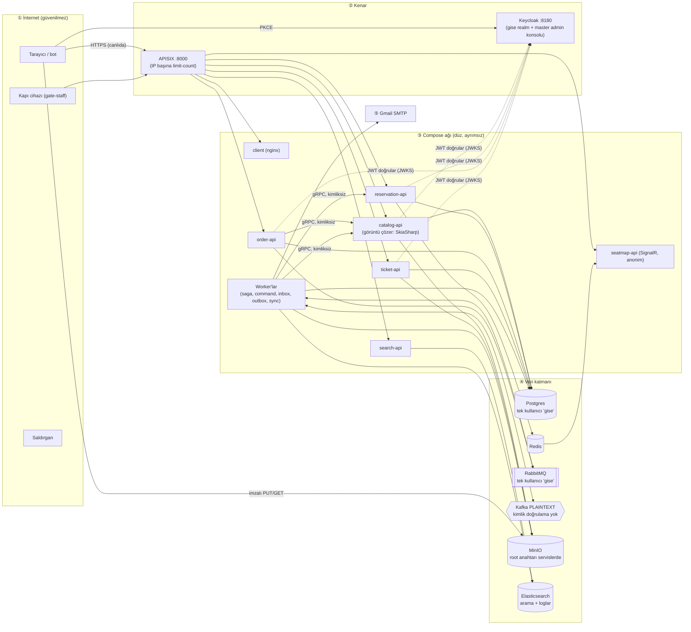

# Gişe — Tehdit Modeli (STRIDE)

> Durum: **Taslak** · Tarih: 2026-11-08 · Kapsam: depodaki bütün uygulama (`docs/tasarim.md`, `deploy/`, servis kodu)
>
> Canlı sistemde doğrulanan ve sonradan değişen maddeler: bkz. 9. Doğrulama.
>
> Buradaki bulgular **eksik kontrol** hipotezleridir, izi sürülmüş istismarlar değildir. Kodda doğrulanmayan
> noktalar "Varsayımlar" bölümünde. Her madde kodla doğrulanana kadar hipotezdir.

---

## 1. Sistem ve varlıklar

Gişe koltuklu bilet satar. Satış anında aynı koltuğa binlerce kişi yarışır. İşin temeli üç şeye dayanır: bir koltuk tek
kişiye satılmalı, para doğru çekilip doğru iade edilmeli, kapıda yalnızca geçerli bilet geçmeli. Dağıtım şu an yerel
docker compose'da (HTTP, `start-dev`). Aşama 6'da HTTPS'li bir sunucuya çıkılacak. Bu model **canlı ortamı** hedef
alır, yalnızca dev'de olan durumlar ayrıca belirtilmiştir.

| # | Varlık | Neden bu sırada |
|---|---|---|
| 1 | **Satışın ve iadenin doğruluğu** (koltuk stoğu, `payments`, `order_payments`) | Çift satış, haksız iade ya da toplu iade doğrudan para kaybıdır |
| 2 | **Bilet kodu ve PDF'i** (QR = kapıdan girme hakkı) | Kod sızarsa başkası girer, asıl sahip kapıda kalır |
| 3 | **Satış anında erişilebilirlik** | Koltuklar botlara ya da DoS'a giderse satış günü kaybedilir, itibar zarar görür |
| 4 | **Ayrıcalıklı hesaplar** (admin, organizer, gate-staff) | Admin etkinliği geri dönüşsüz iptal eder, bu da toplu iade demektir |
| 5 | **Müşteri kişisel verisi** (e-posta, ad, sipariş geçmişi) | KVKK |
| 6 | **Denetim kaydının bütünlüğü** (`logs.audit`, 1 yıl) | Anlaşmazlıkta "kim ne yaptı" sorusunun tek kanıtı |
| 7 | Altyapı sırları (`deploy/.env`: Postgres, MinIO root, SMTP) | Yukarıdaki her şeyin anahtarı |

Kart verisi listede yok: order-api kartı yalnızca doğrular, ileriye sadece son 4 hane gider (tasarım 4.5).

---

## 2. Veri akışı ve güven sınırları

| Sınır | Bugün koruyan | Not |
|---|---|---|
| ① → ② İnternet → APISIX | IP başına dakikalık `limit-count` (`deploy/apisix/seed.sh:50`), tanımsız yol 404 | Kullanıcı başına sınır yok, bot koruması yok, güvenlik başlıkları yok |
| ① → Keycloak | Parola politikası, brute-force koruması, e-posta doğrulama (`deploy/keycloak/gise-realm.json`) | Port `0.0.0.0:8180`'e açık (`deploy/docker-compose.yml:38`), admin konsolu aynı portta, hiçbir rol için MFA yok |
| ② → ③ Gateway → API | JWT (issuer, audience `gise-api`, imza) `src/Shared/Gise.Authentication/KeycloakAuthentication.cs`; rol policy'leri; handler'larda sahiplik kontrolü (ör. `GetOrderByIdQueryHandler.cs:23`) | Sağlam görünüyor |
| ① → MinIO | 5 dakikalık imzalı adresler; `tickets/` herkese kapalı; anahtar regex'le doğrulanıyor (`SetEventPosterCommandValidator.cs:12`) | |
| ③ servis → servis (gRPC, RabbitMQ, Kafka) | **Yalnızca ağda yer almak.** gRPC kimliksiz (tasarım 3.5), Kafka PLAINTEXT (`deploy/docker-compose.yml:78-81`), RabbitMQ'da tek ortak kullanıcı | Ele geçirilen tek bir konteyner bütün mesajları üretebilir |
| ③ → ④ Uygulama → veri | Parolalar `.env`'den geliyor | Bütün servisler aynı Postgres süper kullanıcısını (`gise`) ve MinIO root anahtarını kullanıyor |
| Kullanıcı → admin | Keycloak realm rolleri + her API'nin `Authentication/Policies.cs`'i | Rol yükseltme Keycloak panelinden elle yapılıyor |

---

## 3. Aktörler

- **Anonim internet:** arama, koltuk haritası, etkinlik detayı ve kayıt.
- **Müşteri:** sipariş, ödeme, biletler ve aktarım. Kayıt açık, yalnızca e-posta doğrulaması isteniyor. Toplu hesap açmak ucuz.
- **Bot / karaborsacı:** en motivasyonlu dış aktör. Hedefi popüler etkinliklerde koltukları tutmak ya da satın almak.
- **Organizatör:** kendi taslağını yönetir, görüntü yükler (görüntü çözme yüzeyi).
- **Kapı görevlisi:** girişi açık **her** etkinlikte bilet okutabilir (tasarım 3.8'de kabul edilmiş).
- **Admin:** yayınlar, değiştirir, geri dönüşsüz iptal eder.
- **İçerideki operatör:** `.env`'e, Kibana'ya (`elastic` süper kullanıcısı) ve Keycloak master'a erişimi var.
- **Ele geçirilmiş konteyner:** en olası giriş noktası catalog-api. Güvenilmeyen görüntüleri SkiaSharp'la çözüyor.
- **Ele geçirilmiş bağımlılık:** MediatR, MassTransit, SkiaSharp, QRCoder, npm paketleri.
- **Üçüncü taraf:** Gmail SMTP (hem Keycloak'ın hem Notification'ın e-postaları).

---

## 4. STRIDE tablosu (riske göre sıralı)

| # | Öğe | STRIDE | Tehdit | Olasılık × Etki | Mevcut kontrol | Boşluk |
|---|---|---|---|---|---|---|
| T1 | `POST /api/orders` → Reservation | **D** (iş mantığı) | Çok hesapla koltuk stoklamak: her hesap her etkinlikte 5 koltuğu 10 dakika tutar ve süre dolunca yeniden tutar. Popüler etkinlik "tükenmiş" görünür, gerçek alıcı alamaz | Yüksek × Yüksek → **Yüksek** | IP başına 10/dk; müşteri başına etkinlikte tek bekleyen sipariş (`HOLD_ALREADY_ACTIVE`); 5 koltuk sınırı; e-posta doğrulaması | Kullanıcı başına sınır yok (tasarım 7'de kabul edilmiş), bot doğrulaması yok, tek kullanımlık e-posta engellenmiyor; IP'ler residential proxy'yle ucuza dönüyor |
| T2 | Compose ağı → Kafka / RabbitMQ / Postgres / MinIO | **S, T, E** | Ele geçirilen tek konteyner (ör. kötü niyetli görüntüyle catalog-api) `catalog.events`'e sahte `EventCancelled` yazar. Order bütün tamamlanmış siparişleri iade eder, Ticket bütün biletleri iptal eder. Postgres süper kullanıcısıyla bütün veritabanlarını, MinIO root'uyla bütün bilet PDF'lerini (yani QR'ları) okur | Düşük-Orta × Kritik → **Yüksek** | Portlar dışarıya kapalı; Kafka'da otomatik topic oluşturma kapalı | Servisler arasında kimlik yok, en az yetki yok; patlama yarıçapı "her şey" |
| T3 | Keycloak (admin rolü, master konsolu) | **S, E** | Admin parolası phishing ya da credential stuffing'le ele geçer, etkinlikler geri dönüşsüz iptal edilir ya da sahte etkinlik yayınlanır. Keycloak master konsolu internete açık | Orta × Kritik → **Yüksek** | Brute-force kilidi, 8 karakter parola | MFA yok (`CONFIGURE_TOTP` yalnızca isteğe bağlı action); admin konsolu `:8180`'de herkese açık; `start-dev`, HTTP |
| T4 | Denetim akışı (`Gise.Logging`) | **R** | (a) `client.ip`, X-Forwarded-For'un **ilk** değerinden alınıyor (`src/Shared/Gise.Logging/UserEnricher.cs:51`). APISIX gelen başlığın sonuna ekleme yaptığı için ilk değer saldırganın yazdığı değerdir. (b) Loglar `acks=0` ile gidiyor ve kuyruk dolunca düşürülüyor (tasarım 8): denetim satırı sessizce kaybolabilir. (c) Keycloak giriş ve admin olayları kapalı. (d) `elastic` süper kullanıcısı denetim kaydını silebilir | Orta × Orta → **Orta** | Kim, ne, hangi kayıt ve sonuç yazılıyor; 1 yıl saklanıyor; başarısız denemeler de yazılıyor | Kayıt **inkâr edilemez** değil: IP uydurulabiliyor, satır kaybolabiliyor, kayıt silinebiliyor |
| T5 | SPA (nginx + APISIX yanıtları) | **I, E** | XSS ile bellekteki admin token'ı çalınır; admin ya da kapı sayfası çerçeveye alınıp clickjacking yapılır | Düşük × Yüksek → **Orta** | React varsayılan olarak kaçışlıyor; token `localStorage`'da değil | CSP, `frame-ancestors`, `X-Content-Type-Options`, HSTS hiçbiri yok (`src/Client/nginx.conf`; `seed.sh`'ta başlık eklentisi yok) |
| T6 | catalog-api görüntü işleme | **E, D** | SkiaSharp'ta görüntü çözme CVE'si → RCE. T2'nin giriş kapısı | Düşük × Kritik → **Orta** | Tür ilk baytlardan doğrulanıyor; 5 MB / 40 MP sınırı; upload-url 20/dk; yalnızca organizatör | Çözme işlemi API process'inde yapılıyor, yalıtım yok; kod hangi yetkiyle çalışıyor bilinmiyor (T2) |
| T7 | gRPC (Catalog, Reservation :8081) | **S, I** | Ağdaki herhangi bir konteyner koltuk ve fiyat verisini çeker, Reservation'ı sorgular | Düşük × Düşük → **Düşük** | Port yalnızca iç ağda | Kimlik yok (tasarım 3.5'te kabul edilmiş). Ciddiyetini T2 belirliyor |
| T8 | Search → Elasticsearch | **D** | Herkese açık `fuzziness` + n-gram sorguları 600/dk/IP. Elasticsearch loglarla ortak olduğu için arama yükü denetim kaydının yazılmasını da yavaşlatır | Orta × Düşük-Orta → **Düşük** | IP limiti, sayfa ≤ 48, öneri 2–50 karakter | Arama ve loglar aynı kümede |
| T9 | Bilet aktarımı | **D / kötüye kullanım** | Aktarım ucu, uydurma adreslere platform adına e-posta göndermek için kullanılır | Düşük × Düşük → **Düşük** | Yalnızca sahip olunan bilet, bilet başına tek bekleyen aktarım, 10/dk/IP | Yeterli |
| T10 | Kapıda okutma | **E** | Görevli başka bir mekânın etkinliğinde okutma yapar | Düşük × Düşük → **Düşük** | Okutma etkinlik seçerek yapılıyor, zaman penceresi var, işlem atomik | Görevli etkinliğe atanmıyor (tasarım 3.8'de kabul edilmiş) |
| T11 | APISIX sayacı | **D** | Birden çok düğüme çıkılırsa sınır düğüm sayısı kadar gevşer | Düşük → **Düşük** | Belgelenmiş (tasarım 7) | `policy: local` |

**Atlanan ya da sağlam bulunan yerler**

- **Fiyat ve tutar kurcalama (T):** tutar istemciden değil, Reservation'dan saga'ya gelir. `CustomerId` her uçta token'dan atanır (`OrdersController.cs:32`). Kitle atamasına (mass assignment) açık bir yol görülmedi.
- **IDOR:** sipariş, bilet ve PDF uçlarında sahiplik kontrolü var. Taslak etkinlikte 403 yerine 404 dönülür, var olup olmadığı sızmaz.
- **Bilet kodu tahmini:** 80 bit rastgele. Kaba kuvvetle bulunamaz.
- **Kart verisi:** saklanmıyor. APM'in istek gövdesini yakalamadığı varsayıldı (bkz. Varsayımlar).

---

## 5. En önemli 5 risk

### 1. Koltuk stoklama ve botlar (T1, Yüksek)

- **Kurulacak kontrol:**
  - (a) order-api'de ASP.NET Core `RateLimiter`, `sub`'a göre bölümlenmiş (ör. hesap başına 3 sipariş / 10 dk).
  - (b) Reservation'ın Lua betiğinde **etkinlikten bağımsız** hesap başına aktif tutma sınırı. `hold-user:{etkinlik}:{müşteri}` anahtarının yanına bir `hold-user-total:{müşteri}` sayacı.
  - (c) `POST /api/orders` için Turnstile ya da hCaptcha token'ı; yalnızca yüksek talepli etkinliklerde zorunlu tutulabilir.
  - (d) Keycloak'ta tek kullanımlık e-posta alan adlarını engelleyen bir kayıt kuralı.
- **Kalan risk:** gerçek kişilerle çalışan organize karaborsa (insan çiftlikleri). Bunu yalnızca kimlik doğrulama ya da kuyruk/çekiliş sistemi çözer. Bugünkü ölçekte kabul edilebilir.

### 2. İç ağda yanal hareket (T2 + T6, Yüksek)

- **Kurulacak kontrol:**
  - **Postgres:** her servise yalnızca kendi veritabanına `CONNECT` yetkisi olan, süper kullanıcı olmayan bir rol. Migration'lar ayrı bir sahip rolüyle çalışır.
  - **Kafka:** SASL/SCRAM + ACL. `catalog.events`'e yalnızca `catalog-outbox-worker` yazabilir, inbox worker'ları yalnızca okur.
  - **RabbitMQ:** servis başına kullanıcı, `configure/write/read` izinleri kuyruk adı regex'iyle sınırlı.
  - **MinIO:** catalog için yalnızca `posters/*` ve `staging/*`, ticket için yalnızca `tickets/*` yetkisi olan kullanıcılar. Tasarım 3.6'da zaten "henüz yok" diye not edilmiş.
- **Kalan risk:** ele geçirilen servis kendi verisine ve kendi topic'ine erişmeye devam eder. Bu kabul edilebilir; bütün sistemin düşmesinden çok daha dar.

### 3. Admin hesabı ele geçirme (T3, Yüksek)

- **Kurulacak kontrol:**
  - Keycloak'ta `admin`, `organizer` ve `gate-staff` rolleri için **Conditional OTP** akışı (rol koşullu TOTP ya da WebAuthn zorunlu).
  - Canlıda `start` + HTTPS ve `KC_HOSTNAME_ADMIN` ile master/admin konsolunu yalnızca iç ağdan ya da VPN'den erişilebilir yapmak; gateway'den yalnızca `/realms/gise` yayınlanır.
  - İsteğe bağlı: satılmış bileti olan bir etkinliğin iptali için ikinci bir admin onayı.
- **Kalan risk:** oturum çalan phishing (AiTM). WebAuthn seçilirse bu da büyük ölçüde kapanır.

### 4. Denetim kaydı inkâr edilebilir (T4, Orta)

- **Kurulacak kontrol:**
  - `UserEnricher.ResolveClientIp`'te X-Forwarded-For'un **son** değerini (APISIX'in eklediğini) kullanmak, ya da APISIX'te `proxy-rewrite` ile `X-Real-IP: $remote_addr` başlığını üzerine yazıp yalnızca onu okumak.
  - Keycloak'ta login ve admin olaylarını açmak.
  - `logs-gise.audit` için silme yetkisi olmayan bir okuma rolü kullanmak; mümkünse snapshot.
  - Denetim satırlarının `acks=0` ve "kuyruk doluysa düşür" yolundan çıkarılması. **Mimari karar, açık:** ayrı bir `acks=all` producer mı, yoksa command'la aynı transaction'da outbox mı seçilecek.
- **Kalan risk:** veritabanına doğrudan erişen bir operatör iz bırakmadan değişiklik yapabilir. Bunu ancak Postgres'te `pgaudit` yakalar. Bu ölçekte kabul edilebilir.

### 5. Tarayıcı güvenlik başlıkları (T5, Orta)

- **Kurulacak kontrol:** APISIX global rule'unda ya da `src/Client/nginx.conf`'ta şu başlıklar:
  - `Content-Security-Policy: default-src 'self'; connect-src 'self' <keycloak>; frame-src <keycloak>; frame-ancestors 'none'; object-src 'none'; base-uri 'none'`
  - `X-Content-Type-Options: nosniff`
  - `Referrer-Policy: strict-origin-when-cross-origin`
  - canlıda `Strict-Transport-Security`
- **Kalan risk:** CSP'nin izin verdiği bir kaynaktan gelen tedarik zinciri saldırısı. Bunun için npm lockfile ve bağımlılık taraması yapılmalı.

---

## 6. Kabul edilen riskler

Karar kayıtta dursun diye açıkça yazılmıştır.

- **Kapı görevlisinin her etkinliği seçebilmesi (T10):** görevli zaten güvenilen bir personel ve okutma işlemi denetim kaydına giriyor.
- **İade satın alana gider:** aktarımla bilet alan kişi, etkinlik iptal olursa parasını geri alamaz. Platformda bilet satışı olmadığı için bilinçli bir iş kararı (tasarım 3.8).
- **gRPC'de kimlik doğrulama yok (T7):** 2. risk (ağ ve ACL'ler) kapatılırsa ek değeri düşük. 2. risk kapatılmazsa bu kabul geçerli değil.
- **APISIX'in yerel sayacı (T11):** tek düğüm olduğu sürece.
- **Aramanın loglarla aynı Elasticsearch'te olması (T8):** yük ölçülene kadar.
- **Test ödeme sağlayıcısı:** gerçek sağlayıcıya geçilince ödeme akışının (webhook imzası, idempotency, mutabakat) ayrıca tehdit modeli çıkarılmalı.

---

## 7. Varsayımlar (doğrulanmadı)

1. Canlı ortam tek bir sunucuda docker compose olarak çalışacak; Kubernetes ya da ayrı ağ segmentleri olmayacak.
2. `POSTGRES_USER=gise` resmi imajda süper kullanıcı yaratıyor; servisler için ayrı rol açılmadı (bütün bağlantı dizgilerinde `Username=gise` var).
3. Elastic APM ajanı istek gövdesini yakalamıyor (`CaptureBody` varsayılan olarak kapalı). Yakalıyorsa kart numarası APM'e düşer. **Kontrol edilmeli.**
4. APISIX `X-Forwarded-For`'u eklemeli olarak iletiyor, gelen değeri silmiyor. T4(a) buna dayanıyor.
5. Keycloak'ta e-posta değiştirmek `email_verified`'ı sıfırlıyor (KC 26 varsayılanı). Aktarım eşleşmesi bu sayede güvende.
6. CI'da (`.github/`) gizli bilgi ya da `pull_request_target` kullanımı yok. Workflow dosyaları incelenmedi.
7. Koltuk ve fiyat verisinin herkese açık olması bilinçli bir karar; gizli fiyatlı ya da davetli etkinlik yok.

---

## 8. Sonraki adım

Her madde kodla doğrulanana kadar hipotezdir. Sıralama:

1. **Sipariş akışı ve admin oturumu** (1. ve 3. riskler): kimlik doğrulama incelemesi.
2. **İç ağ yetkileri ve güvenlik başlıkları** (2. ve 5. riskler): altyapı sıkılaştırma incelemesi.

---

## 9. Doğrulama (2026-11-08)

Rapordan sonra çalışan sistemde test edilen ve rapor yazıldıktan sonra değişen maddeler.

| Madde | Sonuç |
|---|---|
| T5 — güvenlik başlıkları | **Doğrulandı.** Ön yüzde CSP, `X-Frame-Options`, `X-Content-Type-Options`, `Referrer-Policy` yok; ayrıca `Server: APISIX/3.16.0` sürüm bilgisini veriyor. |
| T4(a) — `client.ip` uydurulabilir | **Tekrarlanamadı.** `X-Forwarded-For: 6.6.6.6` ile istek atıldı; logda APISIX'in gördüğü adres yazıyor. APISIX başlığı kendisi yazıyor, gelen değeri iletmiyor (varsayım 4 yanlış). Canlıda araya başka bir proxy girerse yeniden değerlendirilmeli. |
| Varsayım 3 — APM istek gövdesi | **Doğrulandı, güvenli.** APM verisinde kart numarası geçmiyor; `Authorization` başlığı `[REDACTED]`. |
| T3 ve sınır tablosu — Keycloak `0.0.0.0:8180`, zayıf parola | **Kısmen kapandı** (commit `1ff87f9`): Keycloak yalnızca `127.0.0.1:8180`'den; en yaygın 10.000 parola reddediliyor; API'ler yalnızca RS256 kabul ediyor, saat toleransı 30 sn. MFA, yönetim konsolu, `KC_HOSTNAME` ve `start` modu canlıya kaldı. |
| T4(b) — denetim satırı kaybolabilir | **Açık, mimari karar bekliyor** (ayrı `acks=all` producer ya da outbox). |

